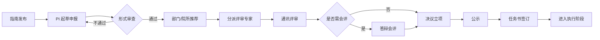

# 01 · 项目申报与立项 PRD

**模块代号**：P（Project Application）  
**优先级**：M1 · P0  
**依赖模块**：07 人员与团队 · 数据字典 · 流程引擎 · AI 中台

---

## 1. 模块概述与目标

覆盖科研院所全部类型项目从"看到指南 → 起草申报 → 提交评审 → 决议立项 → 签订合同"的完整链路。目标是把平均申报周期缩短 30%，一次通过率提升 15%。

**支持项目类型（示例，可在字典中扩展）**：  
国家自然科学基金（面上/青年/重点/重大）· 国家科技重大专项 · 国家重点研发计划 · 中科院战略性先导科技专项 · 省部级基金 · 院所自立项目 · 横向委托课题 · 揭榜挂帅项目。

## 2. 用户角色与核心场景

| 场景 | 主要角色 | 频次 |
|------|---------|------|
| 看到发布的申报指南并报名 | R-STAFF | 高 |
| 起草申报书与预算表 | R-STAFF | 高 |
| 形式审查与推荐上报 | R-MANAGER | 中 |
| 分派评审专家 | R-MANAGER | 中 |
| 在线评审打分与撰写意见 | R-EXPERT | 中 |
| 组织会评答辩 | R-MANAGER | 低 |
| 立项决议与公示 | R-LEADER | 低 |
| 签订合同与任务书 | R-STAFF + R-MANAGER | 中 |

## 3. 用户故事（节选，完整共 26 条）

- **P-USR-01** (P0)：作为科研人员，我希望能看到所有当前开放申报的项目指南，按学科方向、经费类别、截止日期筛选。
- **P-USR-02** (P0)：作为科研人员，我希望能基于历史项目复用信息，一键预填申报书的团队、单位、既往成果部分。
- **P-USR-03** (P0)：作为科研人员，我希望系统能自动校验我的申报书是否符合格式（字数、章节、图表数量）。
- **P-USR-05** (P1)：作为科研人员，我希望 AI 能根据我输入的研究关键词，给出申报书初稿大纲和参考案例。
- **P-USR-08** (P0)：作为科研管理员，我希望能配置任意项目类型的申报模板（字段、章节、附件、审批链），无需开发介入。
- **P-USR-12** (P0)：作为评审专家，我只能看到与我方向匹配、且没有利益冲突的申报书。
- **P-USR-15** (P0)：作为评审专家，我希望能在线打分并撰写意见，评分卡维度可配置。
- **P-USR-19** (P1)：作为科研管理员，我希望 AI 能根据我的评分和评阅要点，帮我起草评审意见初稿。
- **P-USR-22** (P0)：作为院所领导，我希望看到立项决议清单和公示流程。
- **P-USR-25** (P0)：作为科研人员，立项通过后我希望任务书自动生成，我核对签字即可。

## 4. 功能清单

| 编号 | 功能 | 优先级 | 说明 |
|------|------|--------|------|
| P-01 | 申报模板配置 | P0 | 可视化配置字段、章节、附件、评分卡 |
| P-02 | 指南发布与浏览 | P0 | 管理员发布指南，科研人员订阅推送 |
| P-03 | 申报书在线撰写 | P0 | 富文本+结构化+版本+协同批注 |
| P-04 | 预算表在线编制 | P0 | 与经费模块联动，科目字典 |
| P-05 | 形式审查 | P0 | 自动校验字数/附件/签字 |
| P-06 | 多级审批与推荐 | P0 | 部门 → 院所 → 主管 |
| P-07 | 评审专家库管理 | P0 | 方向标签、回避关系、负荷 |
| P-08 | 智能分派评审 | P0 | 按方向匹配、负荷均衡 |
| P-09 | 在线评审与打分 | P0 | 独立打分 + 合议 + 排名 |
| P-10 | 会评与答辩 | P0 | 视频会议 + 现场评分 |
| P-11 | 立项决议与公示 | P0 | 决议记录、公示期、异议处理 |
| P-12 | 任务书生成与签订 | P0 | PDF 模板 + 电子签章 |
| P-13 | AI 申报书起草助手 | P1 | 大纲/初稿/改写 |
| P-14 | AI 预算合规性检查 | P1 | 比对现行政策 |
| P-15 | AI 查重与创新性预判 | P2 | 相似度分析、创新度评分 |
| P-16 | AI 评审意见生成辅助 | P2 | 根据评分要点出草稿 |
| P-17 | 项目备案与重复申报冲突检测 | P1 | 多维备案查询，预警同一选题跨团队/跨人重复申报，输出冲突清单与合并建议（借鉴 Colloa"备案降冲突"）|
| P-18 | 横向/委托项目立项 | P1 | 院所承接横向/委托课题的立项登记、经费来源与成果归属确认；合同链移交模块 G 的 G-10 横向委托合同 |

## 5. 数据模型

### 5.1 主要表

**P_GUIDELINE**（申报指南）  
`id, code, title, project_type, funding_source, target_disciplines(JSON), apply_start_at, apply_end_at, content_rich, attachment_ids, publish_status, tenant_id`

**P_TEMPLATE**（申报模板）  
`id, code, name, project_type, form_schema(JSON), sections(JSON), budget_schema(JSON), review_card(JSON), version, active`

**P_APPLICATION**（申报）  
`id, code, guideline_id, template_id, title, project_type, pi_user_id, member_ids(JSON), department, abstract, research_target TEXT, technical_route TEXT, expected_output TEXT, duration_months, total_budget, apply_status, submit_at, tenant_id`

**P_APPLICATION_DOC**（申报书章节）  
`id, application_id, section_code, content_rich, word_count, updated_at`

**P_BUDGET_DRAFT**（预算草稿）  
`id, application_id, subject_code, subject_name, amount, calc_detail(JSON), ai_compliance_flag, ai_compliance_reason`

**P_REVIEW_TASK**（评审任务）  
`id, application_id, expert_user_id, round(1/2), status, score_total, score_detail(JSON), comment_text, submitted_at`

**P_REVIEW_RESULT**（评审结果）  
`id, application_id, final_score, rank, decision(DRAFT/APPROVED/REJECTED/PENDING_INTERVIEW), decided_by, decided_at, publish_status`

**P_TASK_BOOK**（任务书）  
`id, application_id, code, content_snapshot(JSON), signed_pdf_url, sign_records(JSON), effective_date`

### 5.2 ER 关系

```
P_GUIDELINE 1───N P_APPLICATION 1───N P_APPLICATION_DOC
                         │ 1
                         │   N
                         ├── P_BUDGET_DRAFT
                         ├── P_REVIEW_TASK  N───1 USER(expert)
                         ├── P_REVIEW_RESULT
                         └── P_TASK_BOOK (1:1)
```

## 6. 业务流程与状态机

### 6.1 端到端流程



### 6.2 申报状态机

```
DRAFT → SUBMITTED → FORMAL_CHECK → RECOMMENDED → UNDER_REVIEW → 
INTERVIEWING → DECIDED → PUBLISHED → SIGNED → EXECUTING
                        ↓
                     REJECTED / WITHDRAWN
```

任何状态到 WITHDRAWN 需 PI 主动申请且未进入评审。

## 7. 界面与交互原型

### 7.1 指南列表页 `/apply/guidelines`

顶部筛选：项目类型 / 学科方向 / 截止时间 / 关键词搜索。  
卡片列表：每卡片展示指南标题、发起单位、总盘子、剩余天数倒计时、"我是否可申报"标记（依据人员条件预设匹配）。  
右上按钮："订阅推送"、"AI 推荐匹配指南"（P2）。

### 7.2 申报书撰写页 `/apply/{id}/edit`

三栏布局：  
- 左栏：章节导航树（研究背景/目标/内容/技术路线/预期成果/进度安排/团队/预算/附件）  
- 中栏：富文本编辑区，字段化章节用结构化表单，其他用连续流式编辑  
- 右栏：AI 助手面板 —— 当前章节可点"帮我起草"、"重写这段"、"检查合规"

顶部工具条：字数统计、上次保存时间、版本历史、协作邀请、提交按钮。  
底部固定条：完整性检查（红点标注未填章节）。

### 7.3 预算编制页

表格形式，科目为行、年份为列；每格填写金额，实时校验；科目合计自动计算，总预算受上限约束。  
AI 悬浮提示：科目超支、比例失衡（如间接费用超过 20%）、常见错误模式。

### 7.4 评审管理页（管理员） `/review/dispatch`

左侧待分配申报书列表，右侧专家候选人卡片（按匹配度排序），拖拽分配；显示每位专家当前负荷、回避关系提示。  
一键"AI 智能分派"，管理员确认即可。

### 7.5 专家评审页（专家视角）

单一申报书阅读视图，右侧评分卡面板；每维度打分 + 评语；提交后可撤回 24 小时。

## 8. AI 能力详规

### 8.1 P-13 AI 申报书起草助手

**触发**：申报书编辑页，任意空章节旁的"AI 起草"按钮。  
**输入**：章节类型 + PI 输入的研究关键词 + 项目类型 + 历史同类中标项目（RAG 检索 Top-5，权限隔离）。  
**输出**：结构化文本（章节正文），带内联引用与提示"参考了 3 个类似项目"。  
**置信度**：LLM 输出自评 + 事实校验层判定；< 0.7 时降级为"要点建议"而非"完整草稿"。  
**人工兜底**：用户可"重新生成 / 分段改写 / 关闭 AI 建议"。  
**评估**：采纳率（生成内容被用户保留的比例）、修改幅度（BLEU）。  
**合规**：AI 起草内容必须打水印标记为"AI 生成"，PI 须显式确认。

### 8.2 P-14 AI 预算合规性检查

**触发**：预算表每次失焦保存时，或点"提交前全面检查"。  
**输入**：预算表 + 项目类型 + 现行经费管理办法（RAG 检索）。  
**输出**：风险条款清单，每条含 `{字段, 违反条款, 严重级别, 建议}`；点击跳转条款原文。  
**评估**：合规检查召回率 ≥ 92%，误报率 ≤ 5%。

### 8.3 P-15 AI 查重与创新性预判（P2）

**输入**：申报书全文 + 历史申报库 + 论文库。  
**输出**：相似度分数 + 相似片段高亮 + 创新性打分（新颖度/差异度）。  
**风险控制**：不作为强制驳回依据，仅作管理员参考。

### 8.4 P-16 AI 评审意见生成辅助（P2）

**输入**：专家打分 + 评阅要点 + 申报书。  
**输出**：结构化评审意见草稿（总体评价/优点/不足/建议）。  
**约束**：仅在专家明确点击"生成参考"时触发，专家可编辑后再提交；系统记录 AI 是否被采用。

## 9. 权限矩阵

| 功能 | R-STAFF | R-MANAGER | R-LEADER | R-EXPERT | R-AUDITOR | R-ADMIN |
|------|---------|-----------|----------|----------|-----------|---------|
| 查看指南 | R | CRUD | R | R | R | CRUD |
| 起草/编辑自己的申报 | CRUD(自己) | - | - | - | - | - |
| 提交/撤回 | 自己 | - | - | - | - | - |
| 推荐上报 | - | CRUD | - | - | R | - |
| 分配评审 | - | CRUD | - | - | R | - |
| 评审打分 | - | - | - | CRUD(分派) | R | - |
| 决议立项 | - | R | CRUD | - | R | - |
| 公示 | - | CRUD | R | - | R | - |
| 签订合同 | 自己签 | CRUD | R | - | R | - |
| 配置模板 | - | R | - | - | - | CRUD |

**数据可见性**：评审阶段申报书对专家匿名化（隐藏 PI 与单位信息），会评阶段视项目类型决定是否实名。

## 10. 接口清单（节选）

**对外 REST**：
- `GET /api/v1/apply/guidelines?filters`
- `POST /api/v1/apply/applications` 创建
- `PUT /api/v1/apply/applications/{id}/sections/{code}` 保存章节
- `POST /api/v1/apply/applications/{id}/submit` 提交
- `POST /api/v1/apply/ai/draft` AI 起草
- `POST /api/v1/apply/ai/budget-check` 预算合规
- `POST /api/v1/apply/review/tasks/{id}/score` 提交打分

**内部事件**：
- `application.submitted` → 通知管理员 → 触发形式审查
- `application.recommended` → 触发分派评审
- `review.completed` → 触发决议流程
- `project.approved` → 触发模块 02 创建项目实体

## 11. 异常处理与边界场景

- **超期申报**：截止时间到点后不允许提交，提前 3 天/1 天多次推送提醒。
- **PI 不在职**：申报时校验 PI 状态，非在职一律拦截。
- **重复申报**：同一指南同一 PI 只允许一份；系统级查重（题名相似 > 0.9 弹提示）。
- **申报撤回**：进入评审后禁止撤回，只能终止；终止理由必须填写。
- **专家回避**：与 PI 同单位、3 年内合作过、有师生关系的专家自动排除。
- **评分并列**：并列名次触发复议流程。
- **公示异议**：公示期内任何人可提异议，异议处理流程独立状态机。
- **AI 生成失败**：LLM 不可用时按钮变灰，提示"AI 服务暂时不可用"，不阻塞业务。
- **附件过大**：> 100MB 拒绝上传，走对象存储直传。
- **网络中断**：编辑页自动保存草稿每 30s，本地 IndexedDB 缓存 5 分钟。

## 12. 验收标准与非功能需求

**功能验收**：  
- 支持至少 8 类项目模板可视化配置，配置生效时间 ≤ 5 分钟。  
- 端到端流程（申报 → 立项）可完整跑通，无阻塞点。  
- AI 起草采纳率 ≥ 60%，预算合规召回率 ≥ 92%。

**性能**：  
- 单份申报书保存 < 300ms  
- 指南列表加载 < 500ms（1 万条以内）  
- AI 起草首字节 < 2s，完整返回 < 15s  
- 并发评审 500 人同时在线无卡顿

**可用性**：  
- 表单页支持键盘流（Tab 顺序合理）  
- 富文本编辑器支持 Word 粘贴格式保留  
- 移动端至少支持指南浏览 + 申报进度查询

**安全**：  
- 未立项申报书严格隔离，PI 之间不可互见  
- 评审意见与打分在决议前不得对申请人可见  
- 所有下载与查看留审计

**数据保留**：  
- 申报书及附件永久保留（科研档案要求）  
- 评审意见保留 ≥ 10 年

---

**下一模块**：[02 项目过程管理](./02-项目过程管理.md)
