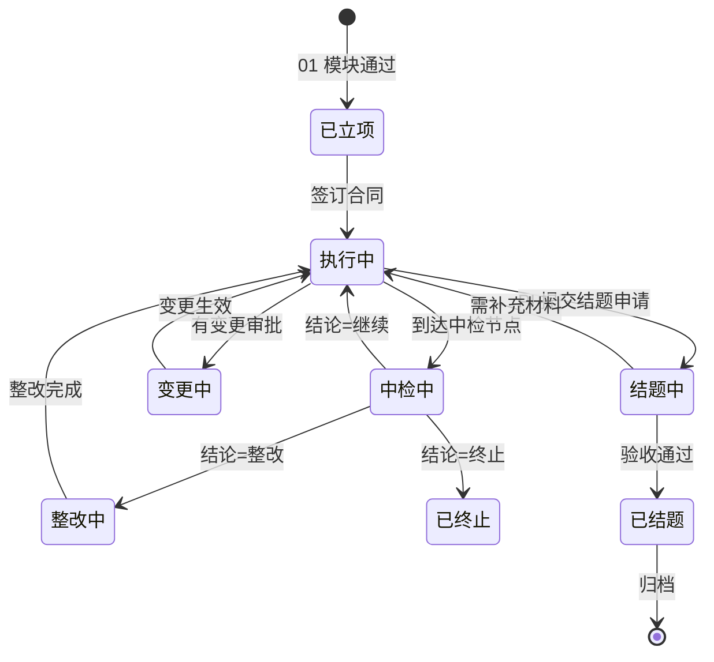

# 02 · 项目过程管理 PRD

**模块代号**：E（Execution）  
**优先级**：M1 · P0  
**依赖模块**：01 申报与立项 · 03 经费管理 · 04 成果管理 · 流程引擎 · AI 中台

---

## 1. 模块概述与目标

覆盖项目立项后的全过程管理：任务分解、里程碑跟踪、中检、变更、结题验收。核心差异化在于**"项目健康度评分"与"AI 风险预警"**——让管理者从被动查询变为主动干预。

**目标**：中检按时完成率从行业平均 65% 提升到 95%；项目延期率下降 30%；重大风险事件提前 60 天可感知。

## 2. 用户角色与核心场景

| 场景 | 角色 | 频次 |
|------|------|------|
| 项目成员查看任务与进度 | R-STAFF | 高 |
| PI 更新项目状态、上传阶段材料 | R-STAFF | 高 |
| 管理员发起中检、审查报告 | R-MANAGER | 中 |
| 专家参加中检评审 | R-EXPERT | 中 |
| 处理变更申请（延期/预算调整/人员变更） | R-MANAGER + R-STAFF | 中 |
| 领导查看项目健康度大盘 | R-LEADER | 低 |
| 结题验收、成果汇总 | R-MANAGER + R-STAFF | 中 |
| 审计追溯全过程 | R-AUDITOR | 低 |

## 3. 用户故事（节选，共 22 条）

- **E-USR-01** (P0)：作为 PI，我能看到自己名下所有项目的当前状态、经费余额、任务到期时间。
- **E-USR-02** (P0)：作为项目成员，我能查看分配给我的任务并更新完成度。
- **E-USR-03** (P0)：作为 PI，我能在中检截止前 30/15/7 天收到提醒，并一键生成中检报告草稿。
- **E-USR-04** (P0)：作为 PI，我发起延期申请时，系统能自动汇总该项目至今的进度、经费使用、已产出成果供审批人参考。
- **E-USR-05** (P1)：作为院所领导，我希望看到全院项目健康度分布，红黄项目高亮。
- **E-USR-06** (P1)：作为 PI，我希望 AI 主动提示"你的项目经费执行率偏低，建议关注"。
- **E-USR-07** (P0)：作为科研管理员，我能配置不同项目类型的中检模板和评分表。
- **E-USR-08** (P0)：作为评审专家，我能在线给中检打分并给出继续/整改/终止结论。
- **E-USR-09** (P0)：作为 PI，变更审批通过后，相关预算、时间、成员自动同步更新，无需重复填。
- **E-USR-11** (P0)：作为审计员，我能追溯任一项目从立项到结题的所有决策点、材料、审批记录。

## 4. 功能清单

| 编号 | 功能 | 优先级 |
|------|------|--------|
| E-01 | 项目台账与看板（列表/卡片/甘特） | P0 |
| E-02 | WBS 任务分解与分配 | P0 |
| E-03 | 里程碑与关键节点跟踪 | P0 |
| E-04 | 进度填报与阶段材料 | P0 |
| E-05 | 项目档案（文档中心） | P0 |
| E-06 | 中检计划与执行 | P0 |
| E-07 | 变更管理（延期/预算/成员/题目） | P0 |
| E-08 | 结题申请与验收 | P0 |
| E-09 | 项目终止与清算 | P0 |
| E-10 | 项目健康度评分（HEALTH SCORE） | P1 |
| E-11 | AI 风险预警 | P1 |
| E-12 | 项目关系视图（跨项目关联） | P2 |
| E-13 | 一键生成中检报告草稿（AI） | P1 |
| E-14 | 一键生成结题报告草稿（AI） | P1 |
| E-15 | 归档材料清单校验与缺项拦截（补 E-05 文档中心） | P0 |
| E-16 | 外协与分包管理（承接 G-09 外协合同与外拨经费） | P0 |
| E-17 | 全程双向追溯（正/反向证据链） | P1 |

## 5. 数据模型

### 5.1 主要表

**E_PROJECT**（执行中的项目，与 01 P_APPLICATION 是 1:1 继承）  
`id, code(项目编号), application_id, title, project_type, pi_user_id, member_ids(JSON), department, start_date, end_date, actual_end_date, status(EXECUTING/MID_CHECK/DELAYED/COMPLETING/CLOSED/TERMINATED), total_budget, received_amount, spent_amount, health_score, risk_level, ethics_case_id, tenant_id`

**E_TASK**（任务/WBS 节点）  
`id, project_id, parent_task_id, name, description, owner_user_id, member_ids, planned_start, planned_end, actual_start, actual_end, progress_percent, status, weight`

**E_MILESTONE**  
`id, project_id, name, due_date, actual_date, evidence_docs(JSON), owner, deliverable_type, status`

**E_PROGRESS_REPORT**（进度填报）  
`id, project_id, period(季度/半年/年), report_type(自报/中检/年度), content_rich, progress_percent, issues_text, next_plan, attachment_ids, submitted_at`

**E_MID_CHECK**（中检主表）  
`id, project_id, check_round, check_date, plan_id, expert_ids(JSON), conclusion(CONTINUE/CORRECT/TERMINATE), score_detail(JSON), report_id, status`

**E_CHANGE_REQUEST**  
`id, project_id, change_type(DELAY/BUDGET/MEMBER/TITLE/SCOPE), old_value(JSON), new_value(JSON), reason, effective_from, approval_status, approved_at`

**E_FINAL_ACCEPT**（结题验收）  
`id, project_id, apply_at, accept_at, output_summary(JSON), finance_report_id, expert_ids, conclusion(PASS/PASS_WITH_CONDITIONS/FAIL), attachment_ids, status`

**E_PROJECT_DOC**  
`id, project_id, category(申报书/任务书/中检/变更/结题/其他), file_url, version, uploaded_by, uploaded_at`

**E_HEALTH_HISTORY**（健康度快照，日切）  
`id, project_id, snapshot_date, progress_score, budget_score, output_score, risk_penalty, total_score, breakdown(JSON)`

### 5.2 ER 关系

```
E_PROJECT 1───N E_TASK（树形自引用）
E_PROJECT 1───N E_MILESTONE
E_PROJECT 1───N E_PROGRESS_REPORT
E_PROJECT 1───N E_MID_CHECK
E_PROJECT 1───N E_CHANGE_REQUEST
E_PROJECT 1───N E_FINAL_ACCEPT
E_PROJECT 1───N E_PROJECT_DOC
E_PROJECT 1───N E_HEALTH_HISTORY
```

## 6. 业务流程与状态机

### 6.1 项目生命周期



### 6.2 变更流程

变更申请 → 影响分析（自动汇总经费/进度/成员变化） → 逐级审批 → 生效 → 通知相关方 → 更新历史快照

## 7. 界面与交互原型

### 7.1 我的项目页 `/project/mine`（PI/成员视角）

顶部指标条：负责项目数、在研数、经费总余额、本月待办。  
下方卡片墙：每卡片显示项目名 · 状态标签（执行中黄/红/绿） · 剩余天数 · 进度条 · 健康分 · 待办事项。  
右上筛选：类型/部门/时间窗。

### 7.2 项目详情页 `/project/{id}`

**概览页**（默认）：  
- 顶部大字号项目名 + 编号 + PI + 起止时间 + 状态徽标  
- 环形进度仪表盘 + 健康分（大号数字 + 语义颜色 + 扣分说明悬浮）  
- 三个 KPI 卡：经费执行率、里程碑完成率、成果数  
- 时间线：从立项起的关键节点滚动列表（评审通过、任务书签、中检、变更、里程碑、结题）  
- 右侧 AI 助手区：显示 AI 生成的项目状态摘要（"该项目当前经费执行率 45%，进度完成 70%，存在结题前突击支出风险"）

**任务与里程碑**：  
- 视图切换：列表 / 甘特 / 看板  
- 拖拽改期、依赖关系箭头、逾期任务红色高亮

**经费视图**：内嵌模块 03 视图

**成果视图**：内嵌模块 04 视图

**档案**：文档分类树，支持全文搜索

**变更历史**：时间轴展示每次变更前后对比

### 7.3 中检管理页 `/project/{id}/mid-check`

表单化的中检报告：进度、经费、成果、问题、下阶段计划。  
一键"AI 起草"按钮，AI 根据项目台账自动生成结构化报告，PI 编辑后提交。  
专家在线打分面板：多维度评分卡 + 评语 + 结论选择。

### 7.4 变更申请页

变更类型选择后，动态表单：延期改日期；预算改科目金额；成员改人员选择。  
**关键设计**：提交前自动展示"影响分析"卡片：经费调整前后对比表、里程碑影响、需重新签订任务书提示。

### 7.5 结题验收页

汇总卡片：项目基本信息 + 经费决算摘要 + 成果清单（从模块 04 拉） + 全部档案附件。  
一键"生成结题报告"，AI 汇聚全过程材料产出结构化报告。  
专家评审面板 + 财务验收面板并行。

## 8. AI 能力详规

### 8.1 E-10 项目健康度评分

**评分公式**（可配置权重）：  
```
health_score = 0.3 × 进度分 + 0.3 × 经费分 + 0.2 × 成果分 + 0.2 × 风险分
进度分 = 已完成里程碑加权 / 应完成里程碑加权
经费分 = 1 - abs(计划执行率 - 实际执行率) × 2  (偏离越大打分越低)
成果分 = 已产出 / 应产出（对照任务书指标）
风险分 = 100 - penalty(变更次数×5, 逾期任务×3, 未批支出×10)
```

**触发时机**：每日凌晨 ETL 后全量刷新；关键事件（变更、支出、成果登记）触发实时刷新。  
**数据展示**：列表/大屏/详情页均显示；红黄绿三档：≥80 绿、60-79 黄、<60 红。  
**AI 归因**：健康分下降时，AI 生成一句话原因（"扣分主要来自经费执行率偏离 + 2 项任务逾期"）。

### 8.2 E-11 AI 风险预警

**规则引擎 + ML 混合**：  
- 确定性规则：经费执行率<30%（临近截止）、连续 3 次变更、逾期任务≥3、中检即将到期  
- 预测模型：基于历史项目特征预测延期风险（XGBoost/LightGBM）  
- LLM 生成风险提示语（自然语言，给出建议动作）

**输出**：预警列表 + 站内消息 + 邮件（严重级别）+ 首页卡片。  
**闭环**：每条预警必须被 PI 或管理员"确认"或"标记误报"，反馈数据回流训练。

### 8.3 E-13/E-14 AI 起草中检/结题报告

**输入**：项目全量数据 + 上次报告 + 模板要求。  
**输出**：完整结构化报告草稿（PI 可编辑）。  
**约束**：不得虚构成果或数据，仅做汇总和语言润色；关键数字必须来自系统。

## 9. 权限矩阵

| 操作 | R-STAFF(PI) | R-STAFF(成员) | R-MANAGER | R-LEADER | R-EXPERT | R-AUDITOR |
|------|-------------|---------------|-----------|----------|----------|-----------|
| 查看项目 | 自己名下 | 参与项目 | 全部 | 全部 | 分配的评审 | 全部（只读） |
| 更新任务 | 全部 | 自己负责 | - | - | - | - |
| 填报进度 | ✓ | - | - | - | - | - |
| 中检发起 | - | - | ✓ | - | - | - |
| 中检打分 | - | - | - | - | ✓ | - |
| 变更申请 | ✓ | - | - | - | - | - |
| 变更审批 | - | - | ✓ | 视级别 | - | - |
| 结题申请 | ✓ | - | - | - | - | - |
| 结题验收 | - | - | 组织 | R | ✓ | - |
| 查看健康度大盘 | 自己 | 自己 | ✓ | ✓ | - | - |

## 10. 接口清单

- `GET /api/v1/project/mine` 我的项目
- `GET /api/v1/project/{id}` 项目详情
- `PUT /api/v1/project/{id}/tasks/{taskId}` 更新任务
- `POST /api/v1/project/{id}/progress-report` 提交进度
- `POST /api/v1/project/{id}/mid-check` 发起/提交中检
- `POST /api/v1/project/{id}/change-request` 变更申请
- `POST /api/v1/project/{id}/final-accept` 结题申请
- `GET /api/v1/project/{id}/health-score?from&to` 健康度历史
- `GET /api/v1/project/{id}/risk-warnings` 风险预警

**内部事件**：`project.status.changed`, `project.health.dropped`, `project.risk.detected`, `project.completed`

## 11. 异常处理

- **PI 离职**：系统冻结项目变更，触发交接流程，重指定 PI。  
- **项目长期不填报**：连续 2 个季度无进度更新自动标黄预警。  
- **中检逾期**：项目状态置为"整改中"，经费支出冻结。  
- **变更冲突**：预算变更与经费实际支出冲突时阻止生效并回退。  
- **结题成果不足**：与任务书指标比对，不足项要求 PI 说明理由。  
- **终止项目**：终止后触发经费清算流程，与模块 03 联动。

## 12. 验收标准与非功能需求

**功能**：中检按时完成率 ≥ 95%；健康度评分覆盖 100% 在研项目；预警准确率 ≥ 70%，误报率 ≤ 20%。  
**性能**：项目列表 1 万条 < 800ms；甘特图渲染 500 任务 < 1s。  
**可用性**：移动端 PI 能查看项目概览、更新任务、审批简单变更。  
**数据**：所有项目关键节点在健康度快照表中留痕，可回溯到任意日期状态。

---

## 13. v1.1 增补要点（Colloa + CoNow 竞品借鉴）

**新增数据模型**（承接 E-15/E-16/E-17）：

E_ARCHIVE_CHECKLIST 归档清单模板
```
id, code, project_type, checklist_json[{item, required, mime}]
stage  申报/中检/结题 触发点
完成度 = 已上传必交项 / 必交项总数（缺项则结题/验收拦截）
```

E_TRACE_NODE 追溯节点（贯穿申报→合同→采购→经费→成果→资产→归档）
```
id, object_type, object_id, biz_code, actor_id, action, occurred_at
prev_node_id  形成有向链；trace_id 支持正/反向一键回溯（联动 README 2.11/2.14）
```

> 外协台账不在本模块建表，统一在模块 G 的 G_OUTSOURCE/G_CONTRACT，E-16 仅做项目侧引用与视图（避免跨模块重复存储，遵循 README 2.15 单一事实来源）。

---

**上一模块**：[01 项目申报与立项](./01-项目申报与立项.md) · **下一模块**：[03 科研经费管理](./03-科研经费管理.md)
