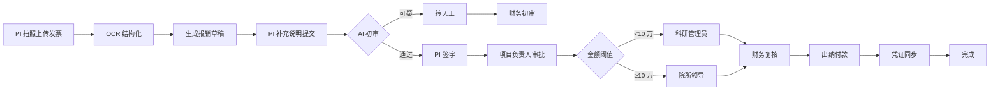

# 03 · 科研经费管理 PRD

**模块代号**：F（Funding）  
**优先级**：M1 · P0  
**依赖模块**：02 项目过程 · 财务系统对接 · AI 中台 · 规则引擎

---

## 1. 模块概述与目标

覆盖科研经费从"预算编制 → 到账认领 → 支出报销 → 预算执行监控 → 决算审计"的全生命周期。目标是构建**符合最新科研经费管理政策（预算制/包干制/间接费用/绩效支出）的多模式经费管理体系**，同时通过 AI 审计降低违规风险、减少财务人员负担。

**行业基准目标**：报销审批平均时长从 5 天缩短至 1 天；违规报销识别率 ≥ 90%；经费执行率预测误差 ≤ 5%。

## 2. 用户角色与核心场景

| 场景 | 角色 | 频次 |
|------|------|------|
| 编制预算与预算变更 | R-STAFF | 高 |
| 经费到账登记与项目匹配 | R-FINANCE | 中 |
| 提交报销与凭证 | R-STAFF | 高 |
| 多级审批报销 | R-STAFF/R-MANAGER/R-FINANCE | 高 |
| 预算执行率查询与预警 | R-STAFF/R-MANAGER | 高 |
| 项目决算审计 | R-FINANCE + R-AUDITOR | 中 |
| 间接费用与绩效支出计提 | R-FINANCE | 中 |
| 违规预警处理 | R-MANAGER + R-FINANCE | 低 |
| 经费监督大屏查看 | R-LEADER | 低 |

## 3. 用户故事（节选，共 28 条）

- **F-USR-01** (P0)：作为 PI，我能在申报阶段按国自然/科技部等模板填写预算，系统自动校验比例上限（如设备费 30%、间接费用 20%）。
- **F-USR-02** (P0)：作为 PI，包干制项目我只需要填写总额和简要依据，不需要拆科目。
- **F-USR-03** (P0)：作为财务人员，我导入银行流水后，系统能自动匹配到账项目（依据付款方、金额、备注），我确认即可。
- **F-USR-05** (P0)：作为科研人员，我能上传发票照片，系统自动 OCR 识别金额、税号、日期，我确认后生成报销单。
- **F-USR-06** (P1)：作为财务人员，AI 能在报销单进入人工审批前先做合规性初审，标出可疑点。
- **F-USR-07** (P0)：作为 PI，我能实时看到项目的可支余额、执行率、超预算提示。
- **F-USR-08** (P0)：作为审计员，我能一键生成任一项目的完整经费审计包（预算/到账/支出/凭证/审批链）。
- **F-USR-10** (P0)：作为科研人员，报销审批完成后系统自动同步凭证到财务系统，无需人工二次录入。
- **F-USR-12** (P1)：作为院所领导，我希望在经费监督大屏看到全院经费池、异常事件、执行趋势。
- **F-USR-15** (P1)：作为 PI，AI 能预测我项目结题时的经费执行率，提前给出调整建议。

## 4. 功能清单

| 编号 | 功能 | 优先级 |
|------|------|--------|
| F-01 | 预算科目字典管理 | P0 |
| F-02 | 预算编制（预算制） | P0 |
| F-03 | 预算编制（包干制） | P0 |
| F-04 | 预算批复与调整 | P0 |
| F-05 | 经费到账登记与认领 | P0 |
| F-06 | 银行流水自动匹配 | P0 |
| F-07 | 报销申请（在线填单） | P0 |
| F-08 | 发票 OCR 与结构化 | P0 |
| F-09 | 多级审批与规则路由 | P0 |
| F-10 | 预算冻结与扣减 | P0 |
| F-11 | 凭证同步财务系统 | P0 |
| F-12 | 间接费用与绩效支出计提 | P0 |
| F-13 | 项目决算与结转结余 | P0 |
| F-14 | 财务审计追溯 | P0 |
| F-15 | AI 发票智能审核 | P1 |
| F-16 | AI 违规模式识别 | P1 |
| F-17 | AI 执行率预测 | P1 |
| F-18 | 经费监督大屏（一图一舱三预警） | P1 |
| F-19 | AI 决算报告生成 | P2 |
| F-20 | 项目全成本核算与分摊（含间接费/折旧/共用成本摊入） | P1 |
| F-21 | 政府会计制度平行记账（财务会计 + 预算会计双分录） | P0 |
| F-22 | 外拨经费管理（联动 G-09 外协合同与 E-16 外协） | P0 |

## 5. 数据模型

### 5.1 主要表

**F_SUBJECT**（经费科目字典，树形）  
`id, code, name, parent_id, level, category(直接费用/间接费用/绩效支出), is_leaf, ratio_limit, applies_to(JSON 项目类型), active`

**F_BUDGET**（项目预算主表）  
`id, project_id, mode(预算制/包干制), total_approved, total_adjusted, version, status(DRAFT/APPROVED/ADJUSTING), approved_at, approved_by`

**F_BUDGET_LINE**（预算明细行）  
`id, budget_id, subject_id, amount_planned, amount_adjusted, amount_frozen, amount_used, amount_released, remaining`

**F_INCOME**（到账记录）  
`id, project_id, receipt_no, receipt_date, amount, payer_name, payer_bank, purpose_text, bank_flow_no, claim_status(未认领/自动匹配/人工认领/存疑), claimed_by, claimed_at, voucher_url`

**F_EXPENSE**（报销主表）  
`id, code, project_id, budget_line_id, applicant_user_id, amount, expense_category, expense_type(设备/材料/差旅/会议/劳务/专家咨询/其他), description, invoice_ids(JSON), attachment_ids, status(DRAFT/SUBMITTED/UNDER_APPROVAL/APPROVED/REJECTED/PAID), submitted_at`

**F_EXPENSE_APPROVAL**（审批流水）  
`id, expense_id, step_order, approver_user_id, role, action(APPROVE/REJECT/RETURN/DELEGATE), comment, acted_at, timestamp`

**F_INVOICE**（发票）  
`id, number, code, invoice_type, seller_name, seller_tax_id, buyer_name, buyer_tax_id, amount_excl_tax, tax_amount, total_amount, issue_date, ocr_confidence, ocr_raw_json, is_duplicated, expense_id`

**F_VOUCHER_SYNC**（凭证同步）  
`id, expense_id, finance_system(用友/金蝶/浪潮), voucher_no, sync_status, sync_at, error_msg`

**F_INDIRECT_FEE**（间接费用计提）  
`id, project_id, period, total_budget, actual_expense, indirect_rate, indirect_amount, performance_amount`

**F_SETTLEMENT**（决算）  
`id, project_id, closing_date, income_total, expense_total, remaining, treatment(结转/收回/留用), audit_report_url, approved_by, status`

**F_ANOMALY**（AI 异常识别）  
`id, expense_id, rule_code, severity(HIGH/MED/LOW), reason_text, evidence(JSON), ai_confidence, resolved_by, resolved_at, resolution`

**F_BUDGET_FORECAST**（AI 预测快照，日切）  
`id, project_id, snapshot_date, expected_execution_rate, deviation_alert`

### 5.2 ER 关系

```
E_PROJECT 1───1 F_BUDGET 1───N F_BUDGET_LINE N───1 F_SUBJECT
E_PROJECT 1───N F_INCOME
E_PROJECT 1───N F_EXPENSE N───1 F_BUDGET_LINE
F_EXPENSE 1───N F_EXPENSE_APPROVAL
F_EXPENSE 1───N F_INVOICE
F_EXPENSE 1───1 F_VOUCHER_SYNC
F_EXPENSE 1───N F_ANOMALY
E_PROJECT 1───N F_INDIRECT_FEE
E_PROJECT 1───1 F_SETTLEMENT
E_PROJECT 1───N F_BUDGET_FORECAST
```

## 6. 业务流程与状态机

### 6.1 报销流程



### 6.2 预算状态机

`DRAFT → SUBMITTED → UNDER_REVIEW → APPROVED → EXECUTING → ADJUSTING → RE_APPROVED → CLOSED`

### 6.3 报销状态机

`DRAFT → SUBMITTED → AI_REVIEW → HUMAN_REVIEW → APPROVED → REJECTED → RETURNED → PAID → VOUCHER_SYNCED`

## 7. 界面与交互原型

### 7.1 项目经费视图（PI 视角）`/project/{id}/funding`

顶部：三大 KPI 卡——总批复额 / 已到账 / 可支余额（大字 + 环形图 + 环比）  
下方左：预算科目表格（科目、批复、调整、已用、可支、执行率进度条）  
下方右：时间轴——最近到账、最近报销、AI 提醒  
底部：报销快捷入口 + 一键生成执行情况表

### 7.2 报销填单页 `/expense/new`

**智能入口**：手机拍发票上传，OCR 自动填充；系统识别发票类型（普票/专票/电子票/行程单）。  
**字段**：项目、科目、金额（从发票带出，可改）、事由（富文本）、参与人、时间、附件。  
**联动**：选择项目 → 自动过滤可用科目；输入金额 → 校验余额；上传发票 → 查重（历史是否已报）。  
**AI 悬浮提示**：当前填写是否可能违规，如"劳务费超过当月工资 40% 上限"。

### 7.3 审批中心（管理者）

统一待办队列：报销审批 / 预算调整审批 / 变更审批 / 决算审批。  
卡片列表 + 侧栏详情。  
关键设计：审批卡片显示"AI 建议"标签（"AI 判定合规，置信度 0.94"或"AI 判定可疑：拆分发票嫌疑"）。  
一键批量审批（限合规项，可疑项强制单独处理）。

### 7.4 财务到账管理页

银行流水导入（CSV/API 对接）→ 系统自动匹配（付款方+金额+备注） → 高置信自动入账，中置信提示确认，低置信转人工。  
未认领到账形成挂账列表。

### 7.5 经费监督大屏（R-LEADER）

**布局**：  
- 顶部：全院经费总盘子 · 本年度到账 · 执行率 · 违规数  
- 中间：地图/热力图按部门分布  
- 左侧：执行率趋势曲线（近 12 月）  
- 右侧：预警滚动列表（事前/事中/事后）  
- 下方：审计追溯时间线，可下钻到项目

### 7.6 决算审计页

一键生成审计包（PDF），包含：预算表 / 到账明细 / 支出明细（含审批链） / 凭证号 / 间接费用计提 / 结余说明。  
审计员在线复核 + 打回 + 备注。

## 8. AI 能力详规

### 8.1 F-15 AI 发票智能审核

**输入**：发票图像 + 结构化数据 + 报销单上下文。  
**处理**：  
- 图像真伪：调用发票查验 API（税总接口）核验  
- 内容异常：金额、日期、税号、开票方合理性  
- 上下文冲突：出差报销日期与差旅日期不重合、餐饮发票人均超标准  

**输出**：`{ verdict: PASS/REVIEW/REJECT, confidence, issues: [{rule, reason, evidence}] }`  
**评估**：召回率 ≥ 90%，误报率 ≤ 3%。

### 8.2 F-16 AI 违规模式识别

**规则集**（部分）：  
- **拆分报销**：同一商家 3 天内多张连号发票合计超阈值  
- **突击花钱**：项目截止前 30 天月均支出 > 项目期均值 3 倍  
- **异常科目**：某科目支出显著高于同类项目均值  
- **循环报销**：报销收款人与付款人存在关联  
- **敏感类别**：烟酒、礼品、旅游类目  

**实现**：Drools 规则 + XGBoost 分类模型（有监督学习历史违规案例）。  
**输出**：F_ANOMALY 记录 + 推送给财务与审计。

### 8.3 F-17 AI 执行率预测

**模型**：基于项目历史同类执行曲线（时间序列 + Prophet/LSTM），预测结题时的执行率。  
**触发**：每日凌晨刷新，误差偏离 > 15% 时推送提醒。  
**输出**：预测执行率 + 建议动作（"当前支出节奏过慢，建议未来 3 月加速采购"）。

### 8.4 F-19 AI 决算报告生成

**输入**：项目全量财务数据 + 项目决算模板 + 现行政策。  
**输出**：结构化决算报告初稿，PI 复核后提交审计。

## 9. 权限矩阵

| 功能 | R-STAFF | R-FINANCE | R-MANAGER | R-LEADER | R-AUDITOR |
|------|---------|-----------|-----------|----------|-----------|
| 查看自己的项目经费 | ✓ | ✓ | ✓ | ✓ | ✓ |
| 查看他人项目经费 | - | ✓ | ✓ | ✓ | ✓ |
| 提交报销 | ✓ | - | - | - | - |
| 审批报销 | 负责人 | ✓ | ✓ | 超阈值 | - |
| 到账登记 | - | CRUD | R | R | R |
| 预算调整申请 | ✓ | - | - | - | - |
| 预算调整审批 | - | ✓ | ✓ | 大额 | - |
| 生成审计包 | - | ✓ | R | R | CRUD |
| 大屏查看 | - | R | R | R | R |

## 10. 接口清单

**外部集成**：
- 银行接口：招行/工行/建行直连或银企对接（导入流水）  
- 税务接口：发票查验 API  
- 财务系统：用友 NC/GX、金蝶 EAS/云星空、浪潮 GS 凭证同步

**内部事件**：
- `expense.submitted` → 触发 AI 初审  
- `expense.approved` → 触发凭证同步  
- `income.claimed` → 更新项目可支余额  
- `budget.remaining.low` → 通知 PI  
- `anomaly.detected` → 通知财务与 PI

## 11. 异常处理与边界场景

- **发票查验失败**：允许先提交，标记"待查验"；48 小时未成功转人工。  
- **科目超支**：软警告 + 硬拦截分级——超预算 0-5% 提示，>5% 拦截。  
- **付款与报销不对齐**：跨月报销允许，但需附加说明。  
- **重复报销**：发票号 + 金额 + 日期 三重指纹查重，命中直接拒绝。  
- **审批人离职**：自动流转到其上级或指定备选人。  
- **凭证同步失败**：重试 3 次，仍失败转人工，UI 显示"待同步"。  
- **包干制项目**：科目字段隐藏，只保留总额与执行率。  
- **绩效支出**：按项目实际到账款的百分比自动计提，超出限额拦截。  
- **AI 判定错误**：PI/审批人可标记"AI 误判"，数据回流训练集。

## 12. 验收标准与非功能需求

**功能验收**：  
- 支持至少 3 种主流财务系统对接（用友/金蝶/浪潮）  
- 至少 6 大行银企直连可用  
- 报销端到端流程（提交 → 到账） < 24 小时（合规项）  
- 决算审计包一键生成，含 15+ 类材料

**性能**：  
- 报销提交 < 500ms  
- 发票 OCR 首字节 < 3s  
- 大屏数据刷新 < 5s  
- 1 万条流水匹配 < 60s

**安全与合规**：  
- 金额相关操作全部走审计日志  
- 财务凭证不可修改，只能冲销  
- 数据传输 TLS 1.3，敏感字段落库加密（AES-256）  
- 满足等保 2.0 三级要求

**可用性**：  
- 移动端支持拍发票、提交、审批  
- 离线草稿保留，网络恢复自动同步

---

## 13. v1.1 增补要点（Colloa + CoNow 竞品借鉴）

承接 F-20/F-21/F-22，新增以下模型与规则：

**F_COST_POOL 项目全成本**（F-20，联动 A-12 折旧分摊）
```
id, project_id, period
direct_cost        DECIMAL  直接费用（报销/外拨/采购等实际支出合计）
indirect_alloc_json  [{type:管理费/房屋/水电气/设备折旧/共用平台, basis, amount}]
full_cost          = direct_cost + Σ间接分摊
basis_rule_id      命中的分摊制度规则（可解释、可复算）
```

**F_ACCOUNTING_ENTRY 平行记账**（F-21，《政府会计制度》双分录）
```
id, source_txn_id(报销/收付/折旧), project_id, period
fin_entry_json     财务会计分录（权责发生制：借/贷科目、金额）
bud_entry_json     预算会计分录（收付实现制：预算支出/资金结存）
posted_finance / posted_budget  两账过账状态；voucher 同步 F-11
reconcile_status   两账勾稽结果（不平则挂账并告警）
```

**F_DISBURSEMENT 外拨经费**（F-22，联动 G-09 外协合同 / G_CONTRACT_PAYMENT）
```
id, code, contract_id(→G), outsource_unit_id(→G_SUPPLIER), project_id
amount, phase(预付/进度/尾款), approval_chain, invoice_url
voucher_status(→F-11), remain_contract_amount(超合同额拦截)
compliance_flags   禁止整体转包/单一来源未说明/关联外协单位等规则命中
```

> 剩余经费提取/结转沿用既有 F-13「项目决算与结转结余」，不重复建表。

---

**上一模块**：[02 项目过程管理](./02-项目过程管理.md) · **下一模块**：[04 科研成果管理](./04-科研成果管理.md)
