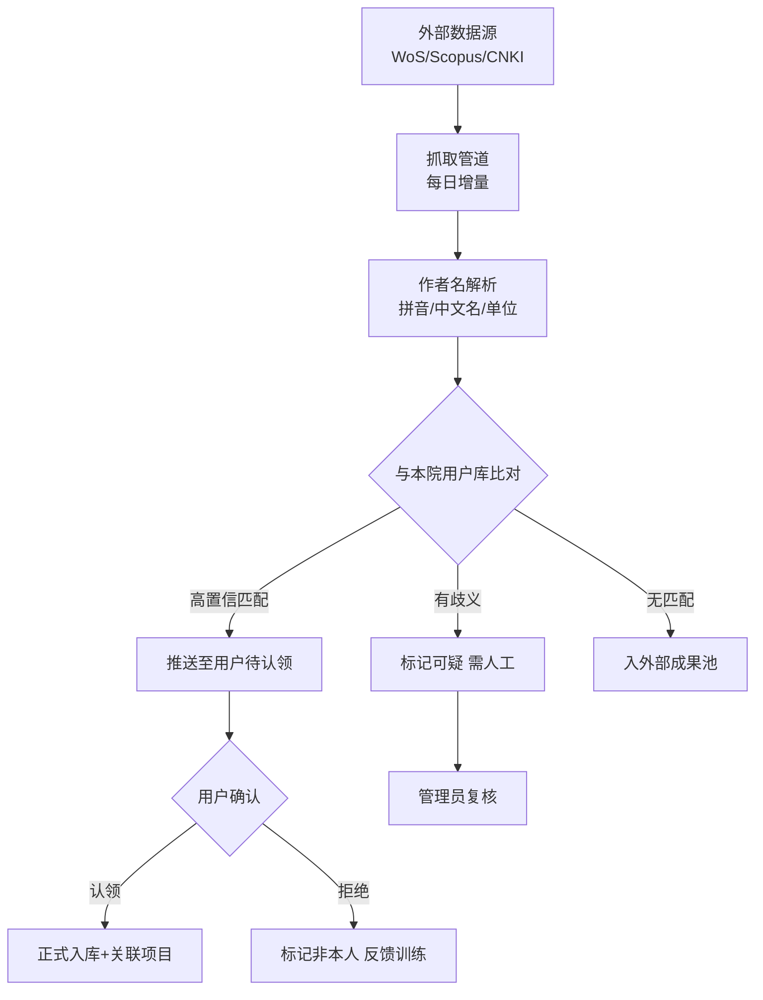

# 04 · 科研成果管理 PRD

**模块代号**：R（Research Output）  
**优先级**：M1 · P0  
**依赖模块**：07 人员与团队 · 02 项目过程 · 数据抓取管道 · AI 中台

---

## 1. 模块概述与目标

覆盖科研院所全类型科研产出的一体化管理：论文、专利、软著、标准、获奖、专著、会议报告、数据集。核心能力是**"自动抓取 + 智能匹配 + 学者认领 + 影响力度量"**——把科研成果登记的行政负担降到最低，同时把数据质量提到最高。

**目标**：科研人员成果登记耗时减少 80%（从每篇 15 分钟到 2 分钟）；论文/专利覆盖率 ≥ 95%；重复率 ≤ 3%。

## 2. 用户角色与核心场景

| 场景 | 角色 | 频次 |
|------|------|------|
| 系统自动抓取论文入库 | 后台管道 | 高 |
| 学者认领归属自己的成果 | R-STAFF | 高 |
| 手动补录未抓到的成果 | R-STAFF | 中 |
| 关联到项目（用于结题） | R-STAFF | 高 |
| 专利维护与费用缴纳 | R-MANAGER | 中 |
| 成果登记考核与绩效 | R-MANAGER | 中 |
| 分类统计与报送 | R-MANAGER | 中 |
| 成果影响力分析与画像 | R-LEADER | 低 |

## 3. 用户故事（节选，共 25 条）

- **R-USR-01** (P0)：作为科研人员，系统能自动从 Web of Science、Scopus、CNKI 抓取我署名的论文，我登录看到"待认领"清单，一键认领即可。
- **R-USR-02** (P0)：作为科研人员，认领时系统能自动匹配作者顺序、通讯作者标记、单位署名归属。
- **R-USR-03** (P0)：作为科研人员，同名作者歧义时系统能提示"这可能是你，也可能不是你"，我确认即可。
- **R-USR-05** (P0)：作为 PI，我能在项目结题时从系统选取本项目产出的成果。
- **R-USR-06** (P0)：作为科研管理员，我能配置哪些成果类型计入绩效、按什么标准计分。
- **R-USR-07** (P0)：作为专利管理员，我能看到所有专利的维持年限、下次缴费日期、代理人。
- **R-USR-10** (P1)：作为科研人员，录入论文时 AI 能自动抓取 DOI、期刊分区、影响因子。
- **R-USR-12** (P1)：作为院所领导，我能看到本院年度高被引论文、Nature/Science 系列、ESI 前 1% 学科分布。
- **R-USR-15** (P1)：作为成果转化办，我能识别哪些专利处于可转化状态（评估过/维持中/未许可）。
- **R-USR-20** (P2)：作为 PI，AI 能预测我新发表论文的引用曲线与影响力。

## 4. 功能清单

| 编号 | 功能 | 优先级 |
|------|------|--------|
| R-01 | 成果类型配置（论文/专利/软著/标准/奖/书/其他） | P0 |
| R-02 | 论文手动录入 | P0 |
| R-03 | 论文自动抓取（WoS/Scopus/CNKI/万方） | P0 |
| R-04 | 智能匹配与去重 | P0 |
| R-05 | 学者认领工作流 | P0 |
| R-06 | 专利全生命周期管理 | P0 |
| R-07 | 软著与标准管理 | P0 |
| R-08 | 科技奖励管理（申报 + 获奖） | P0 |
| R-09 | 专著与编著管理 | P0 |
| R-10 | 成果关联项目 | P0 |
| R-11 | 成果分类分级与绩效计算 | P0 |
| R-12 | 期刊分区与影响因子自动更新 | P0 |
| R-13 | 数据集与软件资源管理 | P1 |
| R-14 | 学术活动（会议/讲座） | P1 |
| R-15 | AI 智能录入辅助（DOI 抓取） | P1 |
| R-16 | AI 影响力评估 | P2 |
| R-17 | 高被引与 ESI 分析 | P1 |
| R-18 | 成果报送（教育部/科技部年报） | P1 |
| R-19 | 成果查重与诚信核验 | P1 |
| R-20 | 成果类型扩充（新品种/布图设计/鉴定成果/荣誉人才称号） | P0 |
| R-21 | 成果动作闭环（申报→确认→变更→查询→统计，回流画像/绩效） | P1 |

## 5. 数据模型

### 5.1 主要表

**R_OUTPUT**（成果主表）  
`id, code, output_type(PAPER/PATENT/SOFTWARE/STANDARD/AWARD/BOOK/DATASET/CONFERENCE), title, title_en, abstract, publish_date, authors(JSON [{user_id, order, is_corresponding, share_pct}]), external_author_names, affiliations(JSON [{user_id, inst_id, is_primary}]), project_ids(JSON), language, source(CNKI/WoS/Scopus/手动/抓取), is_claimed, claim_status, created_at`

**R_PAPER_EXT**（论文扩展）  
`id, output_id, journal_name, journal_issn, volume, issue, page_range, doi, keywords(JSON), category(SCI/EI/北大核心/CSCD/普刊), jcr_partition, cas_partition, impact_factor, cited_times, wos_record_id, scopus_id, cnki_id`

**R_PATENT_EXT**  
`id, output_id, patent_type(发明/实用新型/外观), application_no, application_date, grant_no, grant_date, expiry_date, legal_status(申请中/审中/授权/无效/放弃), inventors(JSON), applicants(JSON), agency_name, annuity_due_date, annuity_paid_until`

**R_SOFTWARE_EXT**（软著）  
`id, output_id, register_no, register_date, copyright_owners, first_release_date, source_code_lines`

**R_STANDARD_EXT**  
`id, output_id, standard_type(国际/国家/行业/团体/企业), standard_no, publish_date, drafting_unit_rank, main_drafters`

**R_AWARD_EXT**  
`id, output_id, award_name, award_level(国家/部/省/学会), award_grade(一/二/三等), award_date, awarding_body, winner_rank(JSON)`

**R_BOOK_EXT**  
`id, output_id, publisher, isbn, publish_date, book_type(专著/编著/教材/译著), word_count, role(主编/副主编/参编)`

**R_CLAIM_RECORD**（认领记录）  
`id, output_id, user_id, action(CLAIM/REJECT/MARK_NOT_MINE/EDIT), edited_fields(JSON), action_at, batch_id`

**R_METRIC_SNAPSHOT**（指标快照，日切）  
`id, output_id, snapshot_date, cited_times, altmetric, downloads`

**R_DATASET**（数据集/软件资源）  
`id, output_id, storage_url, size_bytes, format, license, download_count, citation_count`

### 5.2 ER 关系

```
R_OUTPUT 1───1 R_PAPER_EXT / R_PATENT_EXT / R_SOFTWARE_EXT / R_STANDARD_EXT / R_AWARD_EXT / R_BOOK_EXT
R_OUTPUT 1───N R_CLAIM_RECORD
R_OUTPUT 1───N R_METRIC_SNAPSHOT
R_OUTPUT 1───1 R_DATASET (可选)
R_OUTPUT N───N E_PROJECT (通过 project_ids JSON 或关联表 R_OUTPUT_PROJECT)
R_OUTPUT N───N USER (通过 authors JSON)
```

## 6. 业务流程与状态机

### 6.1 论文自动抓取与认领流程



### 6.2 成果状态机

`AUTO_FETCHED → PENDING_CLAIM → CLAIMED → ASSIGNED_TO_PROJECT → COUNTED_FOR_PERFORMANCE`  
或 `MANUAL_DRAFT → PENDING_REVIEW → CLAIMED → ...`  
或 `REJECTED`（非本人）

### 6.3 专利维护流程

`申请中 → 受理 → 实审 → 授权 → 维持中 → 年费应缴 → 缴费 → 维持/放弃`  
每次状态变更自动通知发明人与专利管理员。

## 7. 界面与交互原型

### 7.1 我的成果页 `/output/mine`（PI 视角）

顶部：年度成果数、被引总数、待认领数  
标签页：论文 · 专利 · 软著 · 标准 · 奖励 · 著作 · 数据集  
每个标签：卡片列表 + 认领/编辑按钮；带 AI 匹配提示"你可能漏认领 3 篇"

### 7.2 待认领中心（首次登录强引导）

大卡片式："系统为你找到 12 篇可能是你发表的论文，是否认领？"  
每卡片显示：标题、期刊、作者顺序、发表年份、置信度、"这不是我 / 是我的 / 待我核对"三按钮。  
一键批量认领 + 部分勾选。

### 7.3 成果录入页 `/output/new`

**智能录入模式**：粘贴论文标题或 DOI → AI 自动抓取所有元数据（作者、期刊、卷期号、影响因子、分区）→ 用户核对补漏。  
**手动录入模式**：表单化，字段级校验；作者选择走人员搜索器（自动带出工号、单位）。  
附件上传：论文全文、检索证明、专利证书、获奖证书。

### 7.4 专利管理页

表格视图 + 甘特视图：每个专利的生命周期时间轴，年费应缴日期高亮。  
批量操作：一键导出缴费清单、批量生成缴费申请书、代理机构协同界面。

### 7.5 成果大屏（R-LEADER）

- 年度成果数量趋势  
- 学科分布饼图  
- 高水平论文（Nature/Science/Cell、TOP SCI）滚动条  
- 专利转化率  
- ESI 学科排名  
- 与同类院所横向对比

### 7.6 项目关联面板

在项目结题页或成果详情页，都能双向维护"本成果归属哪些项目"。

## 8. AI 能力详规

### 8.1 R-04 智能匹配与去重

**输入**：抓取的成果元数据 + 本院学者库（含 ORCID、拼音、曾用名）+ 历史成果库。  
**算法**：作者名模糊匹配（编辑距离 + 拼音 + 单位）+ 标题去重（SimHash + 语义相似度）。  
**输出**：置信度分数 + 匹配到的 user_id 候选。  
**阈值**：>0.95 自动入待认领；0.7~0.95 标可疑；<0.7 只入外部池。  
**评估**：准确率 ≥ 90%，误召率 ≤ 5%（用户点"这不是我"的比例）。

### 8.2 R-15 AI 智能录入辅助

**输入**：标题字符串 或 DOI 或 专利号。  
**处理**：LLM + 外部 API 组合查询（Crossref、专利局）。  
**输出**：结构化元数据 + 数据源出处 + 置信度。

### 8.3 R-16 AI 影响力评估（P2）

**输入**：论文标题 + 摘要 + 作者历史 + 期刊。  
**输出**：预测 3 年/5 年引用曲线、领域内相对影响分。  
**风险**：预测仅供参考，不作为绩效硬指标。

### 8.4 R-17 高被引与 ESI 分析

**算法**：基于 Web of Science 高被引阈值（学科分位数），自动打标。  
**触发**：每日增量更新引用数据。

### 8.5 R-19 成果查重与诚信核验

**输入**：论文全文。  
**处理**：与 CNKI 查重接口对接；图片查重（pHash）；数据表格异常模式识别。  
**输出**：相似度报告 + 可疑片段高亮 + 疑似图片复用清单。

## 9. 权限矩阵

| 操作 | R-STAFF | R-MANAGER | R-AUDITOR | R-LEADER | R-ADMIN |
|------|---------|-----------|-----------|----------|---------|
| 查看自己的成果 | CRUD | R | R | R | - |
| 查看他人成果 | R（公开元数据） | R | R | R | - |
| 认领/拒绝 | 自己相关 | 复核 | - | - | - |
| 手动录入 | ✓ | ✓ | - | - | - |
| 编辑自己的成果 | ✓（限未归档） | ✓ | - | - | - |
| 编辑他人成果 | - | ✓（有审批） | - | - | - |
| 关联项目 | 自己项目 | ✓ | - | - | - |
| 绩效计算 | R | CRUD | - | R | - |
| 报送导出 | - | CRUD | R | R | - |

**可见性规则**：专利"申请中"仅发明人和专利管理员可见；已授权公开可见。学术不端核查结果仅纪检与管理员可见。

## 10. 接口清单

**外部集成**：
- Web of Science API（Clarivate）  
- Scopus API（Elsevier）  
- CNKI API（知网）/ 万方 API  
- 国家知识产权局专利数据  
- Crossref DOI 解析  
- Altmetric 关注度数据  

**内部事件**：
- `output.claimed` → 触发关联项目推荐  
- `output.matched` → 通知学者待认领  
- `patent.annuity.due` → 提前 60/30/7 天通知  
- `paper.cited.updated` → 更新 R_METRIC_SNAPSHOT

## 11. 异常处理与边界场景

- **单位署名歧义**：同一篇论文有 3 个作者来自本单位，作者归属与单位绩效冲突时，走管理员仲裁。  
- **共同通讯作者**：多通讯作者场景，字段设计支持多值，绩效分配规则可配置。  
- **姓名变更**：科研人员改名后，历史成果自动重关联。  
- **抓取失败**：数据源不可用时降级到手动录入 + 增量补抓。  
- **作者挂名**：非实际作者被挂名 → 认领时可"拒绝"并说明理由，走诚信记录。  
- **专利无效**：法律状态变化通过专利局数据源同步，UI 显著标红。  
- **年费逾期**：逾期 30/60/90 天分级通知，超 90 天进入放弃流程需 PI 确认。  
- **重复入库**：SimHash 命中重复时，管理员仲裁保留主记录，其他合并。  
- **单位变更**：学者跳槽后新单位归属处理（原单位保留历史成果）。

## 12. 验收标准与非功能需求

**功能**：  
- 支持 4+ 个数据源增量抓取，每日 < 4 小时完成  
- 智能匹配召回率 ≥ 85%，准确率 ≥ 90%  
- 专利年费到期前 3 次通知 100% 送达

**性能**：  
- 成果搜索响应 < 500ms（10 万条）  
- 抓取管道支持 100 万条总量、10 万条/月增量  
- 认领批量操作 100 条 < 3s

**数据质量**：  
- 字段完整率 ≥ 95%（DOI、分区、影响因子等关键字段）  
- 分区与影响因子每年自动刷新一次

**合规**：  
- 数据源许可协议记录，避免爬虫违规  
- 敏感成果（涉密）单独权限通道

---

**上一模块**：[03 科研经费管理](./03-科研经费管理.md) · **下一模块**：[05 科技成果转化](./05-科技成果转化.md)
