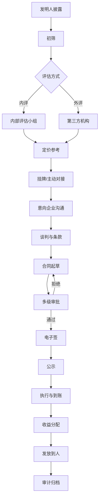

# 05 · 科技成果转化 PRD

**模块代号**：T（Technology Transfer）  
**优先级**：M1-M2  
**依赖模块**：04 成果管理 · 07 人员与团队 · 03 经费管理 · 电子签章 · 评估机构对接

---

## 1. 模块概述与目标

覆盖科技成果从"披露 → 评估 → 定价 → 谈判 → 合同 → 到账 → 分配 → 审计 → 公示"的完整转化链路。目标是打造符合《促进科技成果转化法》（2021 修订）与院所内部管理规定的**一站式转化管理平台**。

**目标**：转化项目全流程周期从平均 6 个月缩短至 3 个月；收益分配争议减少 80%；年度披露与公示自动化。

## 2. 用户角色与核心场景

| 场景 | 角色 | 频次 |
|------|------|------|
| 发明人披露可转化成果 | R-STAFF | 中 |
| 转化办识别潜在转化机会 | R-MANAGER | 中 |
| 内外部资产评估 | R-MANAGER + 第三方机构 | 中 |
| 挂牌发布与企业对接 | R-MANAGER | 中 |
| 谈判与合同起草 | R-MANAGER + 法务 | 中 |
| 多级审批（法务/财务/院所/主管） | 多角色 | 高 |
| 到账认领与收益分配 | R-FINANCE | 中 |
| 奖励发放到人 | R-FINANCE + R-MANAGER | 中 |
| 年度公示与披露 | R-MANAGER | 低 |
| 审计追溯 | R-AUDITOR | 低 |

## 3. 用户故事（节选，共 24 条）

- **T-USR-01** (P0)：作为发明人，我能一键把专利/论文/技术秘密标记为"拟转化"，发起披露。
- **T-USR-02** (P0)：作为转化办，我能在待评估列表中发起内评或外评。
- **T-USR-03** (P0)：作为院所领导，我能看到转化项目的完整决策链和分配方案。
- **T-USR-04** (P0)：作为法务，我能在合同签审环节看到历史相似合同做参考。
- **T-USR-05** (P0)：作为科研人员，转化收益到账后我能看到分配明细，个人奖励部分明确到人。
- **T-USR-06** (P0)：作为审计员，我能一键导出年度转化审计报告（满足法律披露）。
- **T-USR-07** (P1)：作为转化办，AI 能根据专利族相似度和企业技术需求，向我推荐潜在买家。
- **T-USR-08** (P0)：作为科研人员，我发起转让时，系统能自动加载院所有关转让审批权限的门槛（如 500 万以上需理事会审批）。

## 4. 功能清单

| 编号 | 功能 | 优先级 |
|------|------|--------|
| T-01 | 成果披露（拟转化清单） | P0 |
| T-02 | 转化方式配置（转让/许可/作价/合作） | P0 |
| T-03 | 内部评估 | P0 |
| T-04 | 第三方评估机构对接 | P0 |
| T-05 | 挂牌发布与展示门户 | P1 |
| T-06 | 意向企业登记与沟通 | P1 |
| T-07 | 谈判纪要与条款管理 | P0 |
| T-08 | 合同起草与模板管理 | P0 |
| T-09 | 多级审批（法务/财务/院所/主管部门） | P0 |
| T-10 | 电子签章与合同归档 | P0 |
| T-11 | 到账登记与匹配合同 | P0 |
| T-12 | 收益分配规则引擎 | P0 |
| T-13 | 奖励发放到人 | P0 |
| T-14 | 公示与年度披露 | P0 |
| T-15 | 转化绩效统计 | P0 |
| T-16 | 转化审计追溯 | P0 |
| T-17 | AI 转化机会识别 | P2 |
| T-18 | AI 合同条款风险审查 | P1 |
| T-19 | AI 定价参考 | P1 |

## 5. 数据模型

### 5.1 主要表

**T_DISCLOSURE**（披露）  
`id, code, output_id, disclosure_date, disclosed_by, tech_summary, application_scenarios(JSON), maturity_level(TRL 1-9), is_core_tech, target_partners(JSON), status(DRAFT/SUBMITTED/UNDER_EVAL/DEALING/COMPLETED/REJECTED)`

**T_VALUATION**（评估）  
`id, disclosure_id, valuator_type(INTERNAL/EXTERNAL), valuator_name, method(收益法/成本法/市场法), valuation_amount, currency, report_url, valuation_date, valid_until`

**T_DEAL**（转化交易）  
`id, code, disclosure_id, output_id, deal_type(转让/独占许可/排他许可/普通许可/作价投资/合作实施), partner_name, partner_credit_code, contract_amount, payment_method(一次性/分期/入门费+销售提成), royalty_rate, term_start, term_end, status(DRAFT/UNDER_APPROVAL/SIGNED/EXECUTING/COMPLETED/TERMINATED)`

**T_CONTRACT**（合同）  
`id, deal_id, contract_no, contract_file_url, signed_at, seal_records(JSON), legal_opinion, finance_opinion, leader_opinion`

**T_APPROVAL_CHAIN**（审批链）  
`id, deal_id, step_order, approver_role, approver_id, action, comment, acted_at`

**T_INCOME**（转化到账）  
`id, deal_id, received_date, amount, receipt_no, bank_flow_no, payment_phase, voucher_url, allocated(bool)`

**T_DISTRIBUTION_RULE**（分配规则字典）  
`id, rule_name, applies_to(转让/许可/作价), team_pct, institute_pct, individual_pct, min_team_pct, policy_ref, effective_from, effective_to, active`

**T_DISTRIBUTION_RECORD**（分配明细）  
`id, income_id, deal_id, rule_id, team_amount, institute_amount, individual_amount, breakdown(JSON [{user_id, pct, amount, basis}]), issued_at, status`

**T_PUBLICITY**（公示记录）  
`id, deal_id, publish_start_at, publish_end_at, url, objections(JSON), status`

**T_ANNUAL_REPORT**（年度报告）  
`id, year, total_deals, total_income, top_deals(JSON), generated_at, published_at`

**T_ENTERPARTNER**（合作企业库）  
`id, name, credit_code, industry, tech_needs(JSON), contact, past_deals, evaluation_score`

### 5.2 ER 关系

```
R_OUTPUT 1───N T_DISCLOSURE 1───N T_VALUATION
T_DISCLOSURE 1───N T_DEAL 1───1 T_CONTRACT
T_DEAL 1───N T_APPROVAL_CHAIN
T_DEAL 1───N T_INCOME
T_INCOME 1───1 T_DISTRIBUTION_RECORD N───1 T_DISTRIBUTION_RULE
T_DEAL 1───N T_PUBLICITY
T_DEAL N───1 T_ENTERPARTNER
```

## 6. 业务流程与状态机

### 6.1 转化端到端流程



### 6.2 交易状态机

`DRAFT → VALUATED → NEGOTIATING → DRAFT_CONTRACT → UNDER_APPROVAL → APPROVED → PUBLICIZED → SIGNED → EXECUTING → INCOME_RECEIVED → DISTRIBUTED → CLOSED`  
异常路径：`TERMINATED`（谈判破裂/公示异议成立）

## 7. 界面与交互原型

### 7.1 披露管理页 `/transfer/disclosure`

发明人视角：我的披露清单 + 状态跟踪。  
转化办视角：待评估清单 + 批量分配评估人。  
表单字段：技术摘要、成熟度、应用场景、目标客户。

### 7.2 转化机会看板 `/transfer/opportunities`

左侧：待转化成果卡片墙（按学科/成熟度/预期价值过滤）  
右侧：意向企业卡片 + AI 推荐匹配（"这条专利族与华为公开技术需求高度相似"）  
操作：一键发起对接、生成推介材料。

### 7.3 交易详情页 `/transfer/deal/{id}`

顶部：交易状态进度条（10+ 阶段一目了然）  
标签页：基本信息 · 评估报告 · 合同文件 · 审批记录 · 到账明细 · 分配记录 · 公示 · 审计  
每条审批留痕完整展示（谁在什么时间说了什么）。

### 7.4 合同起草与审批页

合同模板库（院所标准模板 + 常见条款片段）；富文本编辑；红线版留存。  
审批面板：法务、财务、院所领导顺序或并行审批，每级看到"AI 条款风险提示"。

### 7.5 分配规则可视化

拖动滑块设定团队/院所/个人比例；系统自动比对院所有关政策条款；如低于最低限则拦截。  
明细生成后按用户逐一展示，需员工确认。

### 7.6 公示门户

公开 URL（不登录也可查看），字段：交易主体、成果摘要、评估价、成交价、分配情况。  
异议提交通道。

### 7.7 年度报告生成

一键生成 PDF，符合《科技成果转化法》年度披露要求。  
可导出给主管部门。

## 8. AI 能力详规

### 8.1 T-17 AI 转化机会识别（P2）

**输入**：待转化专利族 + 外部企业公开技术需求（爬取或对接）。  
**处理**：向量化 + 相似度检索 + 图神经网络识别合作网络。  
**输出**：潜在买家推荐清单，每条含匹配度评分、依据、沟通建议。

### 8.2 T-18 AI 合同条款风险审查

**输入**：合同全文。  
**处理**：LLM 逐条对照《促进科技成果转化法》、《民法典技术合同章》、院所有关规定。  
**输出**：风险条款列表 `{clause, severity, issue, suggestion, ref_article}`；点击跳转条款原文。  
**评估**：召回率 ≥ 85%。

### 8.3 T-19 AI 定价参考

**输入**：标的技术 + 可比交易库 + 行业指标。  
**输出**：定价区间 + 依据 + 可比交易案例。  
**约束**：仅供参考，最终定价以评估机构报告与谈判为准。

## 9. 权限矩阵

| 操作 | R-STAFF | R-MANAGER | R-FINANCE | R-LEADER | R-AUDITOR | 法务 |
|------|---------|-----------|-----------|----------|-----------|------|
| 披露 | ✓ | R | - | - | R | - |
| 评估分派 | - | CRUD | - | R | R | - |
| 挂牌 | - | CRUD | - | R | R | - |
| 谈判 | - | CRUD | - | R | R | - |
| 合同起草 | - | ✓ | - | - | - | ✓ |
| 审批 | - | ✓ | ✓ | ✓ | - | ✓ |
| 电子签 | - | 提交 | - | 签署 | - | - |
| 到账登记 | - | - | CRUD | R | R | - |
| 分配规则 | - | CRUD | ✓ | 审批 | R | - |
| 发放到人 | - | 审核 | ✓ | R | R | - |
| 公示 | - | CRUD | - | R | R | - |

**数据可见性**：交易谈判细节仅参与人可见；公示后相关摘要对外可见；员工只能看到与自己相关的分配。

## 10. 接口清单

**外部集成**：
- 电子签章（e 签宝/法大大/CFCA）  
- 第三方评估机构（上传评估报告 API 或邮件对接）  
- 企业工商信息（天眼查/企查查）验证合作方真实性  
- 国家技术转移交易平台对接（挂牌推送）

**内部事件**：
- `disclosure.submitted` → 通知转化办  
- `deal.signed` → 触发公示倒计时  
- `income.received` → 触发分配计算  
- `distribution.issued` → 通知相关人

## 11. 异常处理

- **交易对手方风险**：签约前自动调用工商信息 API 校验，异常标红。  
- **公示异议**：异议处理独立状态机，未处理前不能进入执行阶段。  
- **分期到账**：每期到账均触发分配，分配规则按合同期比例。  
- **销售提成模式**：需要企业定期上报销售额 → 计算提成 → 分配。  
- **作价入股**：额外管理股权、退出、收益。  
- **合同变更**：重大变更走重新审批链。  
- **提前终止**：违约金条款计算，分配按已到账重算。  
- **发明人异议分配**：仲裁流程，可暂缓发放。

## 12. 验收标准与非功能需求

**功能**：  
- 支持 4 种转化模式（转让/许可/作价/合作）  
- 电子签对接至少 1 家供应商  
- 分配规则可按院所政策可视化配置，历史规则留档

**性能**：  
- 交易列表 < 500ms  
- 合同 AI 风险审查 < 10s  
- 公示页面公开访问支持 CDN

**合规**：  
- 所有交易记录不可篡改（审计日志哈希链可选）  
- 公示页面满足《科技成果转化法》第 27 条要求  
- 分配规则、比例、政策依据完整留档

**数据保留**：交易合同永久保留；公示记录 10 年。

---

**上一模块**：[04 科研成果管理](./04-科研成果管理.md) · **下一模块**：[06 科研诚信与伦理](./06-科研诚信与伦理.md)
