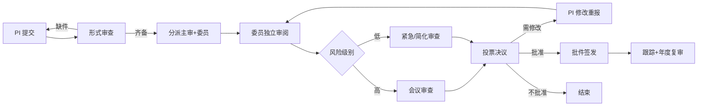

# 06 · 科研诚信与伦理 PRD

**模块代号**：C（Compliance & Integrity）  
**优先级**：M1-M2  
**依赖模块**：01 申报 · 02 过程 · 04 成果 · AI 中台

---

## 1. 模块概述与目标

覆盖科研活动中的合规与伦理要求：伦理审查（IRB）、人类遗传资源、实验动物、生物安全、数据出境、学术不端、诚信档案。目标是让合规审查不再是"事后补票"，而是**嵌入业务前置卡点**——申报未通过伦理则无法提交。

**目标**：伦理审查线上化率 100%；审查平均周期 < 15 天；学术不端预警前置化。

## 2. 用户角色与核心场景

| 场景 | 角色 | 频次 |
|------|------|------|
| 发起伦理审查申请 | R-STAFF | 中 |
| 委员审查与打分 | R-ETHICS | 中 |
| 主审出具审查意见 | R-ETHICS | 中 |
| 跟踪年度复审 | R-STAFF | 低 |
| 人类遗传资源申报 | R-STAFF + R-MANAGER | 低 |
| 学术不端检测 | R-MANAGER | 中 |
| 诚信承诺签署 | R-STAFF | 高（入职/申报） |
| 失信记录管理 | R-MANAGER + 纪检 | 低 |

## 3. 用户故事（节选，共 20 条）

- **C-USR-01** (P0)：作为 PI，我申报涉及人类样本的项目时，系统强制要求关联已批准的伦理批件。
- **C-USR-02** (P0)：作为 PI，我能在线填写伦理申请表并上传研究方案、知情同意书。
- **C-USR-03** (P0)：作为伦理委员，我能查看分配的审查项目并在线打分/给意见。
- **C-USR-04** (P0)：作为主审委员，我能签发批准/修改后批准/不批准的决定。
- **C-USR-05** (P0)：作为 PI，伦理批件到期前 30 天我能收到年度复审提醒。
- **C-USR-07** (P0)：作为科研人员，我每年入职、申报项目、评奖时都需要签署诚信承诺。
- **C-USR-09** (P0)：作为科研管理员，我能对可疑论文/成果触发查重与图片查重。
- **C-USR-11** (P1)：作为纪检，我能为某位学者建立失信档案，记录所有违规事实与处理结果。
- **C-USR-13** (P0)：作为科研管理员，涉及实验动物的项目要关联动物伦理批件。

## 4. 功能清单

| 编号 | 功能 | 优先级 |
|------|------|--------|
| C-01 | 伦理审查类型配置（人体/动物/生安/遗传资源） | P0 |
| C-02 | 伦理审查申请 | P0 |
| C-03 | 分派与主审 | P0 |
| C-04 | 会议审查（在线） | P0 |
| C-05 | 紧急审查（快速通道） | P1 |
| C-06 | 审查决议与批件生成 | P0 |
| C-07 | 年度复审与跟踪 | P0 |
| C-08 | 修正案审查（方案变更） | P1 |
| C-09 | 不良事件报告 | P1 |
| C-10 | 人类遗传资源申报（对接国家备案） | P0 |
| C-11 | 实验动物伦理与许可证 | P1 |
| C-12 | 生物安全审批 | P1 |
| C-13 | 数据出境合规审查 | P1 |
| C-14 | 学术不端检测（查重/图片/数据） | P1 |
| C-15 | 诚信承诺签署 | P0 |
| C-16 | 失信档案与处理 | P0 |
| C-17 | AI 伦理风险预判 | P2 |
| C-18 | AI 学术不端识别（进阶） | P2 |
| C-19 | 涉密与合规审查联动（涉密事项移交模块 X，本模块不存涉密正文） | P1 |

## 5. 数据模型

### 5.1 主要表

**C_ETHICS_CASE**（伦理审查案卷）  
`id, code, review_type(HUMAN/ANIMAL/BIO_SAFETY/HGR/DATA_EXPORT), project_id, applicant_user_id, protocol_title, protocol_summary, methodology, risk_level, informed_consent_url, materials(JSON), status(DRAFT/SUBMITTED/UNDER_REVIEW/NEEDS_REVISION/APPROVED/REJECTED/EXPIRED), submitted_at, decision_date, valid_until`

**C_REVIEWER_ASSIGN**（分派）  
`id, case_id, reviewer_user_id, role(CHIEF/BOARD), assigned_at, deadline, status`

**C_REVIEW_OPINION**  
`id, case_id, reviewer_user_id, score, comments, risks_identified(JSON), recommendation(APPROVE/APPROVE_WITH_CHANGES/REJECT)`

**C_MEETING_RECORD**（会审纪要）  
`id, case_id, meeting_date, attendees, discussion_text, decision, vote_result(JSON)`

**C_DECISION_LETTER**  
`id, case_id, decision_type, letter_no, letter_url, issued_at, expires_at`

**C_AMENDMENT**（修正案）  
`id, case_id, change_summary, materials, status, decided_at`

**C_AE_REPORT**（不良事件）  
`id, case_id, event_date, severity, description, action_taken, reported_at`

**C_ANNUAL_REVIEW**  
`id, case_id, review_year, progress_summary, incidents, next_plan, status`

**C_INTEGRITY_PLEDGE**（承诺）  
`id, user_id, pledge_type(入职/申报/评奖/年度), content_version, signed_at, signature_url, ip, ua`

**C_INTEGRITY_RECORD**（失信档案）  
`id, user_id, event_type(抄袭/数据造假/一稿多投/违规报销/利益冲突未申报/其他), discovered_date, evidence(JSON), case_no, investigation_status, decision, sanction, sanction_effective_until, is_public`

**C_MISCONDUCT_SCAN**（学术不端检测记录）  
`id, target_type(PAPER/DEAL/OUTPUT), target_id, scan_type(TEXT_DUP/IMAGE_DUP/DATA_ANOMALY), score, report_url, scanned_at, verdict`

**C_HGR_FILING**（人遗资源）  
`id, project_id, filing_type(采集/保藏/国际合作/开发利用), filing_no, national_approval_no, submission_date, approval_status, approval_date, expiry_date`

### 5.2 ER 关系

```
E_PROJECT 1───N C_ETHICS_CASE
C_ETHICS_CASE 1───N C_REVIEWER_ASSIGN
C_ETHICS_CASE 1───N C_REVIEW_OPINION
C_ETHICS_CASE 1───N C_MEETING_RECORD
C_ETHICS_CASE 1───1 C_DECISION_LETTER
C_ETHICS_CASE 1───N C_AMENDMENT
C_ETHICS_CASE 1───N C_AE_REPORT
C_ETHICS_CASE 1───N C_ANNUAL_REVIEW
C_ETHICS_CASE 1───1 C_HGR_FILING（可选）
USER 1───N C_INTEGRITY_PLEDGE
USER 1───N C_INTEGRITY_RECORD
```

## 6. 业务流程与状态机

### 6.1 伦理审查流程



### 6.2 案卷状态

`DRAFT → SUBMITTED → FORMAL_CHECK → UNDER_REVIEW → NEEDS_REVISION → APPROVED / REJECTED → MONITORING → EXPIRED`

## 7. 界面与交互原型

### 7.1 伦理申请页 `/ethics/apply`

表单化：研究类型 → 动态字段；上传方案/知情同意书/招募材料；一键"AI 预审"检查关键要素是否齐备。

### 7.2 案卷详情（PI 视角）

状态进度条 + 委员意见（匿名）+ 补件要求 + 批件下载 + 复审提醒。

### 7.3 委员工作台 `/ethics/board`

待审列表 + 每案卷打分面板；批阅模式：PDF 阅读器 + 侧栏意见；讨论区（会审前异步沟通）。

### 7.4 会审管理（管理员）

议题安排 + 出席签到 + 表决记录 + 自动生成纪要。

### 7.5 承诺签署页

电子签名板 + 承诺文本 + 阅读倒计时 + 存证。

### 7.6 失信档案页

员工个人档案中的"诚信"标签页：承诺记录、可疑扫描、正式失信记录、处理决定。仅纪检与本人可见（部分对外公开）。

## 8. AI 能力详规

### 8.1 C-14 学术不端检测

**多维检测**：  
- 文字查重：与 CNKI/Turnitin 等接口  
- 图片查重：pHash + CNN 特征匹配，识别拼接/复用  
- 数据异常：Benford 定律、方差异常、重复值模式  
- 参考文献：虚假引用识别

**触发**：成果登记时自动扫描；立项前对申报书扫描；管理员手动触发。

### 8.2 C-17 AI 伦理风险预判

**输入**：伦理申请研究方案。  
**处理**：LLM 检索类似研究的历史风险事件 + 关键要素完整性。  
**输出**：风险点清单 + 需补充材料。  
**用途**：辅助 PI 完善、辅助委员聚焦。

### 8.3 C-18 AI 学术不端识别（进阶）

**目标**：识别图片篡改、数据选择性呈现、方法描述缺失等。  
**方法**：多模态 LLM + 图像异常检测 + 与历史相似模式对比。

## 9. 权限矩阵

| 操作 | R-STAFF | R-ETHICS | R-MANAGER | 纪检 | R-AUDITOR | R-ADMIN |
|------|---------|----------|-----------|------|-----------|---------|
| 提交伦理申请 | ✓ | - | - | - | - | - |
| 审阅与打分 | - | 分派案件 | - | - | - | - |
| 签发批件 | - | 主审 | - | - | - | - |
| 查看案卷 | 自己 | 分派 | 全部 | 全部 | 全部 | - |
| 修正案 | ✓ | ✓ | R | R | R | - |
| 失信记录 | 自己可见 | - | CRUD | CRUD | R | - |
| 学术不端扫描 | 触发自己 | - | ✓ | ✓ | R | - |

**保密**：伦理案卷涉及受试者信息，严格权限隔离；批件编号可查，内容不可查。

## 10. 接口清单

**外部**：
- 国家人类遗传资源管理服务系统（备案对接）  
- CNKI 查重 API  
- Turnitin API（可选）  
- 电子签名服务

**内部事件**：
- `ethics.approved` → 解锁申报提交（跨模块联动）  
- `ethics.expiring` → 通知 PI 复审  
- `misconduct.suspected` → 通知管理员  
- `integrity.record.created` → 通知本人（可申诉）

## 11. 异常处理

- **审查超期**：委员未在时限内完成，自动升级并通知管理员催办。  
- **利益冲突**：委员与 PI 同部门或有师生关系时，强制回避。  
- **批件过期**：项目无法继续开展，经费支付自动冻结。  
- **异议/申诉**：失信记录允许本人申诉，独立流程。  
- **数据出境**：涉密数据无法出境，AI 需识别关键词拦截。

## 12. 验收标准

**功能**：  
- 支持 5 类伦理审查流程配置  
- 与至少 1 个查重接口打通  
- 批件编号可外部验证（公开 URL + 二维码）

**合规**：  
- 满足《赫尔辛基宣言》、《涉及人的生命科学和医学研究伦理审查办法》（2023）等法规  
- 案卷保留 ≥ 10 年  
- 知情同意书可追溯

**性能**：  
- 单案卷 PDF 加载 < 2s  
- 查重扫描 1 万字符 < 60s

---

**上一模块**：[05 科技成果转化](./05-科技成果转化.md) · **下一模块**：[07 人员与团队](./07-人员与团队.md)
