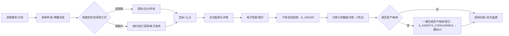
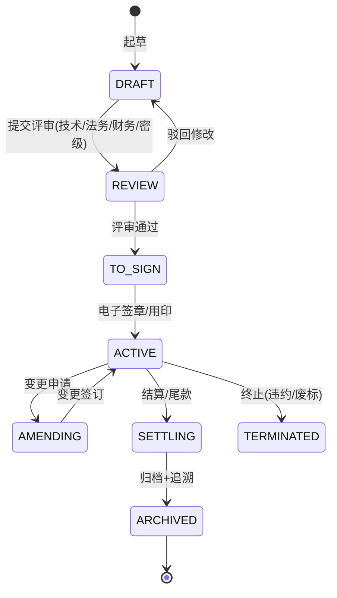

# 09 采购与合同管理（模块 G）

**代号**：G（Procurement & Contract）  
**版本**：v1.1 · **日期**：2026-10-13  
**里程碑**：M1（采购申请/合同基础）→ M2（招标比价/履约/外拨）  
**上游**：`../PRODUCT_PLAN.md` 5.9 横切能力、竞品借鉴（科南 CoNow"采购与合同"、蓝凌 Colloa"任务书/主合同 + 外协合同"）  
**编号前缀**（详见 `README 2.11` 注册表）：采购申请 `REQ`、采购订单 `ORD`、合同 `CON`、外协/分包合同 `OSC`、供应商 `SUP`、外协单位 `SOSC`

---

## 1. 模块概述与目标

本模块统一管理科研院所"花钱买东西、对外签协议"的全部活动，覆盖三条合同主线：**采购合同（设备/材料/服务）、外协（分包）合同、横向委托合同**。它补齐了 v1.0 的重大空白——此前只有经费报销（F）却没有"先审批采购、再签合同、再到货验收、再付款入账"的前置链条，导致大额支出与审计在"合同"处断链。

设计目标：

1. 让每一次采购从"需求 → 计划 → 申请报批 → 选定采购方式 → 招标/比价/询价 → 订单 → 到货验收 → 合同 → 履约付款 → 转资产"全流程闭环、留痕；
2. 采购方式（公开招标/邀请招标/竞争性谈判/单一来源/询价/自行采购）由**金额限额 + 制度包**自动判定（对齐 `README 2.10` 制度规则引擎），人不越权；
3. 合同、外拨经费（→ F-22）、到货资产（→ A 模块 10）三者在同一单据链上联动，杜绝"合同与付款两张皮"；
4. 涉密采购（`README 2.13`）在办公内网/涉密网分区处理，密级字段贯穿单据。

非目标：不做政府采购电子卖场对接的成品实现（提供标准适配层，M2 起按需接入）；财务核算的分录细节属 F 模块。

---

## 2. 用户角色与核心场景

| 角色 | 在本模块的核心动作 |
|------|--------------------|
| R-STAFF（科研人员） | 发起采购需求/申请；填报技术参数；确认到货验收；发起外协意向 |
| R-MANAGER（科研管理员） | 审核采购申请的立项归属；组织比价/招标；维护供应商库与外协单位库 |
| R-FINANCE（财务） | 复核采购预算占用、合同付款条款；执行付款与凭证；外拨经费复核 |
| R-LEADER（院所领导） | 审批大额采购与重大合同；查看采购执行看板 |
| R-AUDITOR（审计/纪检） | 只读全链路追溯：为什么买、为什么选这家、为什么这个价、付款依据 |
| R-ADMIN | 维护采购方式限额规则（制度包）、合同模板、审批流编排 |
| （外）供应商/外协单位 | 通过门户提交报价/资质、确认合同、上传交付物（受限外部身份） |

**核心场景**：

- 场景一（设备采购）：PI 为某重点研发项目申请一台 120 万电镜 → 系统判定超过公开招标限额 → 走公开招标 → 中标 → 生成采购合同 → 到货验收 → 自动登记为固定资产并摊入项目成本。
- 场景二（试剂耗材小额）：实验室申请 3000 元常规试剂 → 低于限额 → 自行采购/电子卖场 → 一键转耗材入库（→ 10）。
- 场景三（外协分包）：某项目将"第三方检测"外协给院外机构 → 外协单位资质入库 → 签订外协合同 → 依合同外拨经费（→ F-22）→ 外协成果回传关联项目。
- 场景四（横向委托合同）：院所承接企业委托开发 → 横向合同评审（技术/法务/财务/密级）→ 签订主合同 → 约定经费/成果归属 → 履约里程碑与到账款匹配。

---

## 3. 用户故事（节选，含优先级）

| ID | 用户故事 | 优先级 |
|----|---------|--------|
| US-G-01 | 作为 PI，我提交采购申请时，系统自动按金额与经费性质给出"应采用的采购方式"和法律依据 | P0 |
| US-G-02 | 作为 PI，我的采购申请自动占用对应项目预算科目，不超预算才能提交 | P0 |
| US-G-03 | 作为管理员，我能发起线上比价/招标，记录各家报价与评标过程，可被审计复算 | P0 |
| US-G-04 | 作为管理员，供应商须先资质入库才能进入合同，黑名单供应商被硬拦截 | P0 |
| US-G-05 | 作为财务，合同签订后付款条款（预付/到货/尾款）自动生成付款计划并提醒 | P0 |
| US-G-06 | 作为审计，我能从任一付款反查到采购申请、方式判定、评标、合同、验收全链 | P0 |
| US-G-07 | 作为管理员，我把部分任务外协时，外协单位资质审查与外拨额度受控 | P0 |
| US-G-08 | 作为科研员，横向合同评审意见（技术/法务/财务/密级）能在线汇总并留痕 | P1 |
| US-G-09 | 作为 PI，AI 能读取我上传的采购合同 PDF，抽取金额/付款条件/交付物/违约责任 | P1 |
| US-G-10 | 作为 PI，AI 对我上传的合同做风险条款体检（付款节点、知产归属、违约金、涉密外泄） | P1 |
| US-G-11 | 作为领导，我看到采购执行率、节资率、超方式采购占比的看板 | P1 |
| US-G-12 | 作为管理员，采购到货后一键生成就绪的资产/耗材登记单（→ 10） | P1 |

---

## 4. 功能清单与优先级

| 功能 | 说明 | 优先级 |
|------|------|--------|
| G-01 采购需求与计划 | 按项目归集采购需求，形成年度/项目采购计划与预算 | P0 |
| G-02 采购申请与预算占用 | 在线申请，实时冻结对应经费科目，超预算拦截 | P0 |
| G-03 采购方式判定引擎 | 依金额、经费性质、制度包自动判定采购方式并给出依据 | P0 |
| G-04 供应商库与资质 | 供应商入库、资质证照、黑名单、分级 | P0 |
| G-05 招标/比价/询价 | 线上发标、报价、评标记录、结果公示、节资统计 | P0 |
| G-06 采购订单与到货验收 | 下单、到货登记、验收单、质量与数量确认 | P0 |
| G-07 合同全生命周期 | 起草→评审→用印→履行→变更→结算→归档 | P0 |
| G-08 付款计划与执行 | 按合同付款条款生成计划，关联 F 模块付款与凭证 | P0 |
| G-09 外协（分包）合同 | 外协单位库、资质审查入库、外协合同、外拨计划（联动 F-22） | P0 |
| G-10 横向委托合同 | 院所承接横向课题的主合同签订与履约里程碑 | P0 |
| G-11 电子签章与用印 | 第三方 CA 对接、异地签署、用印审批（联动 P-12） | P0 |
| G-12 合同/采购台账与追溯 | 多维台账 + 一键正反向追溯（联动 E-17） | P0 |
| G-13 **AI 合同智能解析** | 上传 PDF/Word 抽取甲乙方、金额、付款、交付、期限、违约等 | P1 |
| G-14 **AI 合同风险审查** | 规则红线 + LLM 提示风险条款并给修改建议 | P1 |
| G-15 **AI 采购合规助手** | 自然语言答疑"这类该用什么方式/需要什么材料" | P1 |
| G-16 采购执行看板 | 执行率、节资率、超方式采购、待付款预警 | P1 |
| G-17 到货即转资产/耗材 | 验收通过一键推送登记单（→ 模块 10） | P1 |
| G-18 供应商门户 | 外部报价、上传资质、查看中标与合同（隔离外网域） | P2 |
| G-19 电子卖场/政采云对接 | 标准适配层接入外部交易平台 | P2 |

---

## 5. 数据模型

### 5.1 主要表（默认通用字段见 `README 2.2`，此处省略；均含 `legal_entity_id`、`security_level`、`policy_pack_id`）

**G_REQUISITION 采购申请**
```
id, code(REQ-年-序), tenant_id, legal_entity_id, security_level
project_id           FK  关联项目（P/E）
applicant_id         FK  申请人
category             enum 设备/材料/试剂耗材/服务/软件/外协
item_name, spec      采购标的与技术参数
est_amount           DECIMAL(18,2) 预算金额
budget_subject_code      占用科目（→ F）
frozen_amount            冻结金额（联动 F-10）
purchase_way         enum 判定结果（见 G-03）
way_basis_rule_id        命中的制度规则号（可解释）
policy_pack_id           所用制度包版本
status               enum DRAFT/SUBMITTED/WAY_DECIDED/BIDDING/ORDERED/CANCELLED
```

**G_SUPPLIER 供应商/外协单位库**
```
id, code(SUP=供应商 / SOSC=外协单位), name, credit_code, type(供应商/外协单位/服务商)
qualification_json   资质证照（ISO/CNAS/保密资质等）
grade                enum A/B/C/D
blacklist            tinyint  是否黑名单
review_status        enum PENDING=待审查/IN_LIBRARY=已入库/REJECTED=驳回/EXPIRED=到期
expire_date
```

**G_BID 招标/比价记录**
```
id, requisition_id FK, method(公开/邀请/竞谈/单一来源/询价)
publish_at, bid_open_at, award_at
bids_json          [{supplier_id, price, score, tech_eval, commercial_eval}]
winner_supplier_id, saving_amount(节资), winner_reason
publicity_status   enum PUBLICIZING=公示中/AWARDED=已定标/CHALLENGE=质疑处理
```

**G_CONTRACT 合同（统一）**
```
id, code(CON=采购/技术服务/横向 / OSC=外协分包)
contract_type      enum 采购/外协分包/横向委托/技术服务/其他
project_id FK, supplier_id FK(=G_SUPPLIER)
party_a, party_b, amount, currency
pay_terms_json     [{phase:预付/到货/验收/质保, ratio, trigger}]
deliverables_json  交付物清单
sign_date, start_date, end_date
sign_method        enum 电子签/异地/纸质   (联动 P-12)
archive_checklist_id  归档清单（→ E-15）
security_level     涉密密级（涉密合同仅涉密网）
status             enum DRAFT=起草/REVIEW=评审中/TO_SIGN=待签/ACTIVE=履行中/AMENDING=变更/SETTLING=结算中/ARCHIVED=已归档
ai_parse_json      G-13 解析结果   ai_risk_json G-14 风险提示
```

**G_CONTRACT_PAYMENT 付款计划/执行**
```
id, contract_id FK, phase, plan_amount, plan_date
paid_amount, pay_date, expense_id(→ F 报销/付款单), voucher_status(→ F-11)
invoice_url, outsource_flag(是否外拨 → F-22)
```

**G_ORDER 采购订单**
```
id, code(ORD-年-序), tenant_id, legal_entity_id, security_level
requisition_id FK, contract_id FK(可空·限额内自行采购无合同), supplier_id FK(=G_SUPPLIER)
order_amount, currency, order_date, expect_delivery_date
delivery_status   enum PENDING=待发货/SHIPPED=在途/ARRIVED=到货/ACCEPTED=验收合格/REJECTED=拒收
acceptance_by, acceptance_date  验收人/日期
converted_asset   到货转资产标记（→ G-17 / 模块10 A_ASSET·A_CONSUMABLE）
status            enum DRAFT=草稿/CONFIRMED=已确认/EXECUTING=执行中/COMPLETED=已完成/CANCELLED=已取消
```

**G_OUTSOURCE 外协台账**（从属于 contract_type=外协）
```
contract_id FK, outsource_unit_id FK(=G_SUPPLIER type=外协单位)
scope 外协任务范围, outsource_amount 外拨总额
disbursed_amount 已拨, progress 外协进度, deliverable_check 成果验收
compliance_note  合规说明（不得整体转包等）
```

### 5.2 ER 关系

```
G_REQUISITION ─┬─(1:0..1)→ G_BID ─(N:1)→ G_SUPPLIER
               ├─(1:0..1)→ G_CONTRACT ─┬─(1:N)→ G_CONTRACT_PAYMENT ─(1:1)→ F_EXPENSE
               │                        ├─(1:1)→ G_OUTSOURCE(外协) → F-22 外拨
               │                        └─(1:N)→ G_ORDER
               └─(1:N)→ G_ORDER（限额内自行采购·contract_id 可空）
G_ORDER ─(N:1)→ G_SUPPLIER
G_ORDER ─(到货 1:N)→ A_ASSET / A_CONSUMABLE（模块10 · G-17）
G_CONTRACT / G_ORDER ─(project_id)── E_PROJECT ── 台账/追溯(E-17/G-12)
```

状态机见第 6 节。

---

## 6. 业务流程与状态机

### 6.1 采购到付款（P2P）端到端



### 6.2 合同状态机



---

## 7. 界面与交互原型

**7.1 采购申请页 `/procurement/new`**：表单 + 预算科目选择器（显示剩余额度）；金额输入即时触发"采购方式判定"卡片，展示命中规则号与制度依据（G-03）。附件走对象存储，密级字段受 `security_level` 控制可见域。

**7.2 采购/合同台账 `/procurement/ledger`**：多维筛选（项目/方式/合同类型/供应商/状态）；列含金额、节资、付款进度、健康色条；行内"追溯"打开正/反向链路（联动 E-17）。对应 prototype"采购与合同"屏。

**7.3 合同评审页 `/contract/{id}/review`**：左合同预览（PDF 带 AI 高亮风险条款），右四方评审意见（技术/法务/财务/密级），底部条款 diff 与版本；一键套打送审版（`README 2.14`）。

**7.4 外协管理页 `/contract/outsource`**：外协单位资质入库流 + 外拨进度条 + 合规校验（禁止整体转包、单一来源需说明）；外拨审批与 F-22 联动。

**7.5 到货验收页 `/procurement/receipt`**：验收单（数量/质量/序列号），通过后"生成资产/耗材登记"按钮推送到模块 10。

---

## 8. AI 能力详规（遵循 `README 2.4` 八要素）

### 8.1 G-13 AI 合同/采购单据智能解析
- 触发点：上传合同/招标文件 PDF/Word 时。
- 输入：原始文件 + 项目上下文 + 主数据（供应商/科目）。
- 输出：结构化 JSON `{party_a, party_b, amount, currency, pay_terms[], deliverables[], period, penalty}` 写入 `ai_parse_json`，用户确认后落字段（不覆盖已确认数据）。
- 可解释性：逐字段标注抽取来源（页码/原文片段）。
- 置信度：字段级 0–1，<0.85 标黄要求人工复核。
- 人工兜底：金额、付款条款等关键项强制人工确认后才能进入付款计划。
- 评估：抽取字段准确率、字段完整率；上线后周监控。
- 数据回流：人工修正 diff 回流训练集。

### 8.2 G-14 AI 合同风险审查
- 触发点：合同评审页"风险体检"按钮。
- 输出：风险卡片列表 `{clause, risk_type(付款/知产/违约/保密/期限), level, suggestion, 命中规则号}`。
- 分工：红线（金额、账期、违约金比例）走制度规则；语义风险（知产归属模糊、保密义务缺失）走 LLM + RAG（政策库/历史合同）。
- 置信度与兜底：风险等级"高"必须法务人工签署意见；AI 不得单独放行。

### 8.3 G-15 AI 采购合规助手
- RAG 问答："50 万国产设备采购要走什么方式、需要哪些材料？"引用制度包条款，附出处；无法确定时转人工/管理员。

---

## 9. 权限矩阵（节选，遵循 `README 2.1/2.12/2.13`）

| 功能 | R-STAFF | R-MANAGER | R-FINANCE | R-LEADER | R-AUDITOR | R-ADMIN |
|------|---------|-----------|-----------|----------|-----------|---------|
| 发起采购申请 | 本单位/本项目 | ● | | | 读 | 配置 |
| 采购方式判定 | 读 | 读 | 读 | 读 | 读+复算 | 规则维护 |
| 组织招标/评标 | | 本法人 | | 审批 | 读 | |
| 供应商/外协库 | 读 | 本法人维护 | 读 | | 读 | |
| 合同评审 | 我方 | 组织 | 财务条款 | 大额审批 | 读 | 模板 |
| 付款计划执行 | | 读 | 本法人 | 审批 | 读 | |
| 追溯/台账 | 本人 | 本法人 | 本法人 | 全院 | 全部只读 | |

说明：涉密合同（`SECRET/TOP_SECRET`）仅在涉密网可见；跨法人合同由主责法人经办、参与法人只读（`README 2.12`）；R-ADMIN 在三员模型下无权查看涉密内容（`README 2.13`）。

---

## 10. 接口清单（节选，遵循 `README 2.5`）

- `POST /api/v1/procurement/requisitions` 创建采购申请（含预算冻结）
- `GET  /api/v1/procurement/requisitions/{id}/way` 返回采购方式判定与依据
- `POST /api/v1/procurement/bids` 发标；`POST /api/v1/procurement/bids/{id}/award` 定标
- `POST /api/v1/contract` / `PUT /api/v1/contract/{id}/review` / `POST /api/v1/contract/{id}/sign`
- `POST /api/v1/contract/{id}/ai-parse` / `POST /api/v1/contract/{id}/ai-risk`
- `GET  /api/v1/contract/{id}/trace` 正/反向追溯链（联动 E-17）
- `POST /api/v1/contract/{id}/payment-plan`；付款执行回调 `POST /api/v1/finance/expense`（→ F）
- `POST /api/v1/asset/from-receipt` 到货转资产/耗材（→ 10）
- `GET  /api/v1/supplier?type=外协单位&status=已入库`

内部依赖：F（预算冻结/凭证/外拨）、E（项目与追溯）、A（资产/耗材）、P（电子签章）、X（密级与法人）。

---

## 11. 异常处理与边界场景

- **超预算提交**：预算冻结失败即拦截，提示可调科目与剩余额度；不允许负余额。
- **规避化整为零**：同一申请人/项目短期内多笔贴近限额的拆单，由 F-16 式规则识别并转人工审核（拆分采购预警）。
- **中标后弃标/废标**：合同状态回退 `TO_SIGN→REVIEW`，冻结预算释放，评标记录保留并标注原因。
- **供应商资质过期**：入库状态自动置 `到期`，禁止新合同引用，历史合同只读。
- **合同与付款金额不一致**：付款计划累计不得超过合同金额（含变更），超出触发规则拦截。
- **整体转包/违规外协**：外协范围若≈项目全部任务，制度规则强制说明并升级审批。
- **涉密合同误下互联网域**：`security_level≥SECRET` 的单据在非涉密网访问一律拒绝并审计告警。
- **电子签失败/CA 不可用**：降级为纸质签署并补传扫描件，状态机允许 `TO_SIGN` 记录线下签署。
- **多法人口径冲突**：跨法人合同金额计入主责法人，参与法人按比例展示，避免重复并表。

---

## 12. 验收标准与非功能需求

**功能**：P2P 全流程走通；采购方式判定 100% 给出规则依据；合同→付款→凭证→追溯链完整；到货转资产/耗材无重复录入。

**权限**：跨租户/跨法人越权被拒；涉密合同在非涉密域不可见；三员职责隔离生效。

**性能**：台账查询 < 500ms；合同 PDF 解析首结果 < 8s；AI 风险审查 < 5s；批量导入 1 万条 < 30s。

**合规**：采购方式判定与金额阈值可复算（保留 `policy_pack_id` 快照）；满足《招标投标法》《政府采购法》及院所内控与审计要求；等保三级与信创部署（`README 2.13`）。

**审计**：任一付款可反查至采购申请与评标依据；所有关键操作字段级 diff 留痕，不可篡改。
