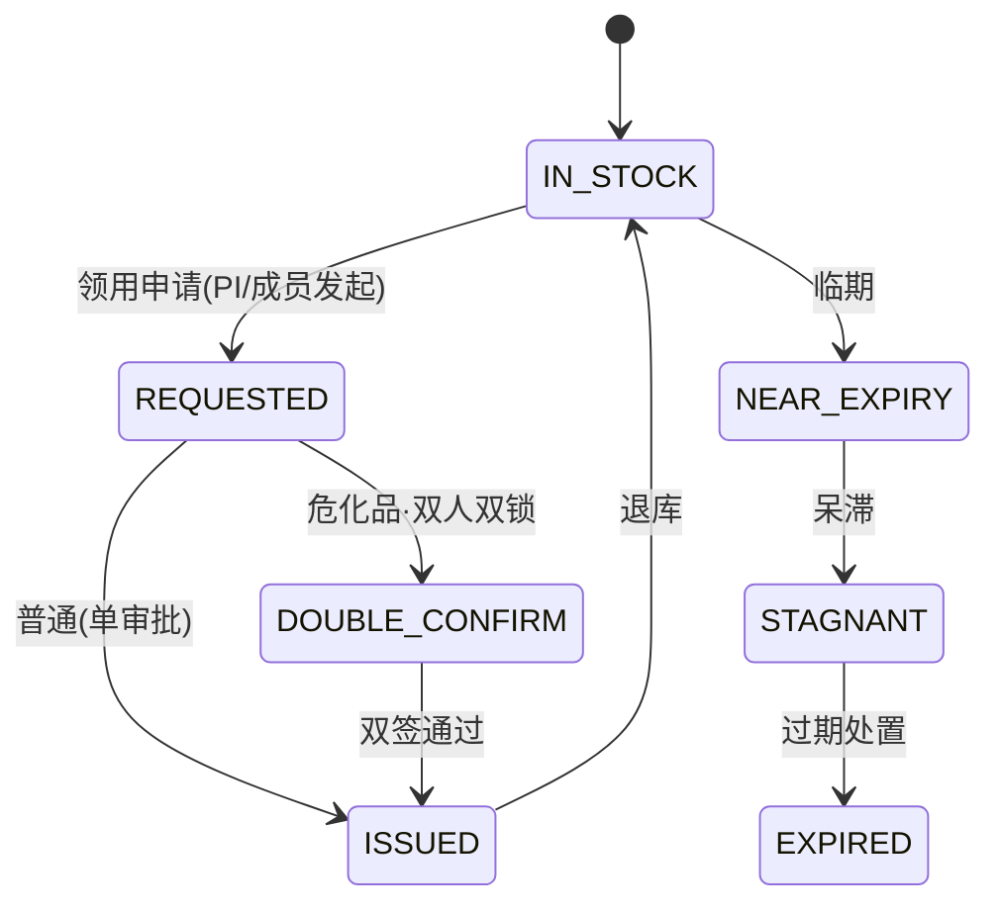

# 10 资产与耗材管理（模块 A）

**代号**：A（Asset & Consumable）  
**版本**：v1.1 · **日期**：2026-10-13  
**里程碑**：M1（资产台账/耗材出入库基础）→ M2（折旧/成本分摊/危化品/盘点）  
**上游**：`../PRODUCT_PLAN.md` 5.9 横切能力、竞品借鉴（科南 CoNow"资产与耗材：验收入库→登记→领用→维修保固→处置、折旧与账实一致、成本分摊到项目"）  
**编号前缀**：资产 `AST`、耗材批次 `CON-B`、领用单 `ISS`、处置单 `DSP`

---

## 1. 模块概述与目标

面向科研院所的"家底管理"：把科研用**固定资产、无形资产、低值易耗品/试剂耗材**纳入统一生命周期，并与项目、经费、采购打通，实现 **账（财务账）、卡（资产卡）、物（实物）、项目（成本归属）四对齐**。这是 v1.0 完全缺失、而 CoNow 明确列出、且科研审计高度关注的域（设备重复购置、试剂流失、账实不符、折旧未摊入项目成本）。

设计目标：

1. 资产从"采购到货验收（←G-17）→ 登记建卡 → 领用/放置 → 调拨 → 维修保固 → 盘点 → 折旧 → 处置"全周期可追溯；
2. 耗材/试剂支持**批次、效期、危化品**管控与库存预警，领用可归集到项目；
3. 设备折旧与占用按规则**分摊进项目全成本**（联动 F 模块成本核算）；
4. 与财政/上级资产报表口径一致，支持"账实一致"稽核与一键对账。

非目标：不做物联传感实时定位（提供接口预留）；采购流程本身属 G 模块。

---

## 2. 用户角色与核心场景

| 角色 | 核心动作 |
|------|---------|
| R-STAFF | 资产领用/归还申请；耗材领用；报修；名下资产确认 |
| R-MANAGER | 资产建卡、调拨、盘点组织；耗材目录维护 |
| R-FINANCE | 资产价值入账、折旧计提、处置残值、对账 |
| R-LEADER | 大型仪器设备共享率、闲置率、重复购置看板 |
| R-AUDITOR | 账实一致稽核、处置合规追溯、单台设备全生命周期档案 |
| R-ADMIN | 资产分类字典、折旧政策（制度包）、条码/RFID 规则 |
| 资产管理员/库管员（细分岗） | 实物收发、库存、危化品双人双锁 |

**核心场景**：

- 设备：电镜到货验收 → 自动建资产卡（价值/存放地/责任人/项目来源）→ 纳入折旧计划 → 月度折旧额分摊到使用项目成本。
- 试剂：危化品乙醚入库（批次+MSDS+双人双锁）→ PI 团队领用登记到项目 → 效期预警 → 空瓶按危废处置。
- 共享：50 万以上大型仪器设备纳入共享台账，记录机时/使用率，防止重复购置（采购前置校验）。
- 处置：设备报废走技术鉴定 → 处置审批 → 残值入账 → 档案封存可追溯。

---

## 3. 用户故事（节选）

| ID | 用户故事 | 优先级 |
|----|---------|--------|
| US-A-01 | 作为管理员，采购验收后系统自动带出资产建卡所需字段，无需重复录入 | P0 |
| US-A-02 | 作为科研员，我能扫码领用耗材并关联到具体项目 | P0 |
| US-A-03 | 作为库管员，危化品必须双人双锁、领用双人确认并记录用途 | P0 |
| US-A-04 | 作为财务，资产按月计提折旧并生成凭证（→ F） | P0 |
| US-A-05 | 作为审计，我能查看任一资产从验收到处置的完整档案与责任链 | P0 |
| US-A-06 | 作为科研员，名下到期/闲置资产有提醒，处置须审批留痕 | P1 |
| US-A-07 | 作为领导，我看到大型仪器使用率与全院重复购置预警 | P1 |
| US-A-08 | 作为财务，资产折旧能按规则分摊进项目全成本 | P1 |
| US-A-09 | 作为管理员，RFID/条码盘点自动比对生成盘盈盘亏 | P1 |
| US-A-10 | 作为科研员，AI 读取发票/合同自动补全资产卡信息 | P1 |

---

## 4. 功能清单与优先级

| 功能 | 说明 | 优先级 |
|------|------|--------|
| A-01 资产分类与折旧政策 | 分类字典 + 折旧方法/年限（制度包可配） | P0 |
| A-02 资产建卡登记 | 固定资产/无形资产台账，含价值、存放、责任人、来源 | P0 |
| A-03 到货转资产 | 承接 G-17，验收通过自动生成待确认资产卡 | P0 |
| A-04 条码/RFID 标签 | 一物一码，扫码查询与盘点 | P0 |
| A-05 领用/归还/调拨 | 责任转移与放置地变更，全程留痕 | P0 |
| A-06 维修保固 | 报修工单、维保合同关联、停机记录 | P0 |
| A-07 耗材/试剂出入库 | 批次、效期、库存水位、FIFO 领用 | P0 |
| A-08 危化品管控 | 双人双锁、MSDS、用量与危废处置 | P0 |
| A-09 折旧计提 | 按月计提并生成财务凭证（→ F-11） | P0 |
| A-10 资产处置 | 报废/变卖/转让，技术鉴定与审批、残值入账 | P0 |
| A-11 账实一致对账 | 财务账 vs 资产卡 vs 实物三方对账 | P0 |
| A-12 项目成本分摊 | 设备折旧/占用按规则摊入项目全成本（→ F） | P1 |
| A-13 大型仪器共享 | 机时登记、使用率、对外开放与结算 | P1 |
| A-14 盘点 | 计划盘点/扫码盘点、盘盈盘亏处理 | P1 |
| A-15 **AI 资产卡自动补全** | 从发票/合同抽取品牌型号序列号价值 | P1 |
| A-16 **库存智能预警** | 效期、低于安全库存、呆滞、异常领用 | P1 |
| A-17 **AI 重复购置识别** | 结合共享率与同类资产存量给出闲置/重复预警 | P2 |

---

## 5. 数据模型

### 5.1 主要表（通用字段见 `README 2.2`；均含 `legal_entity_id`、`security_level`）

**A_ASSET 资产卡（固定/无形）**
```
id, code(AST-年-序), tenant_id, legal_entity_id
asset_type       enum 固定资产/无形资产
category_code    FK  资产分类字典
name, brand, model, serial_no
value            DECIMAL(18,2) 入账原值
purchase_date, in_date
depr_method      enum 直线/工作量/…   depr_years
depr_accum       DECIMAL(18,2) 累计折旧   net_value 净值
custodian_id     FK  责任人   dept_id 存放部门   location 存放地
source_type      enum 采购/自研/捐赠/调拨   source_ref(G_CONTRACT/…)
project_id       FK  形成/占用项目（成本归属）
usage_rate           使用率（大型仪器）
share_flag, open_flag  是否纳入共享/对外开放
security_level   涉密资产（涉密网登记，实物隔离）
status           enum PENDING_RECEIPT=待验收/IN_USE=在用/IDLE=闲置/UNDER_MAINT=维修/TRANSFERRING=调拨中/PENDING_DISPOSE=待处置/DISPOSED=已处置
```

**A_CONSUMABLE 耗材/试剂库存**
```
id, sku, name, category(试剂/耗材/元器件/办公)
is_hazard      tinyint  危化品   hazard_level   msds_url
stock_qty, unit   batch_no, produce_date, expire_date   safe_stock
location, custodian_id
status         enum IN_STOCK=在库/LOW_STOCK=低库存/NEAR_EXPIRY=临期/EXPIRED=过期/STAGNANT=呆滞
```

**A_STOCK_TXN 出入库/领用流水**
```
id, type enum 入库/出库/领用/归还/退库/危废处置/盘盈/盘亏
ref_asset_id / ref_sku, qty, amount
project_id(领用归属), operator_id, double_confirm_by(危化双人)
related_expense_id(→ F), txn_time, balance_after
```

**A_DEPRECIATION 折旧记录**
```
id, asset_id FK, period(YYYY-MM), depr_amount
alloc_project_ids  [{project_id, ratio, amount}]  → 成本分摊依据
voucher_id(→ F-11), posted tinyint
```

**A_DISPOSAL 处置单**
```
id, code(DSP-年-序), asset_id FK, method 报废/变卖/转让/销毁
appraisal 技术鉴定意见, residual_value 残值
approval_chain, related_voucher(→ F), archive_ref(→ E-05)
status APPLIED=申请/APPRAISED=鉴定/APPROVED=审批/EXECUTING=执行/BOOKED=入账/ARCHIVED=归档
```

### 5.2 ER 关系
```
G_ORDER(验收) ─1:1→ A_ASSET/A_CONSUMABLE ─(领用/出库)→ A_STOCK_TXN →(归属)→ E_PROJECT / F_EXPENSE
A_ASSET ─(按月)→ A_DEPRECIATION ─(分摊)→ F 项目全成本 ; ─(凭证)→ F-11
A_ASSET ─→ A_DISPOSAL ─→ F(残值) ; 台账/追溯 → E-17/G-12
```

---

## 6. 业务流程与状态机

### 6.1 资产全生命周期

```mermaid
flowchart LR
  V[到货验收 G-17] --> C[建卡登记+贴标]
  C --> U[在用/领用/放置]
  U --> M[维修保固/调拨]
  M --> U
  U --> D[折旧计提→项目成本分摊]
  D --> P[盘点(账实一致)]
  P --> R{处置?}
  R -->|否| U
  R -->|是| X[技术鉴定→处置审批→残值入账→归档]
```

### 6.2 耗材/危化品领用状态机

> token ↔ 中文：IN_STOCK=在库 · REQUESTED=领用申请 · DOUBLE_CONFIRM=双人确认 · ISSUED=已出库 · NEAR_EXPIRY=临期 · STAGNANT=呆滞 · EXPIRED=过期处置。

---

## 7. 界面与交互原型

**7.1 资产台账 `/asset/ledger`**：卡片+表格双视图；列含资产名/型号/责任人/存放地/净值/状态/项目来源；健康标识（闲置、待处置、账实不符）。对应 prototype"资产与耗材台账"屏（含折旧、领用、库存预警卡片）。

**7.2 耗材库存 `/asset/consumable`**：批次/效期水位条；临期与低库存高亮；危化品专区双锁标识；一键领用（关联项目）。

**7.3 领用/出库页 `/asset/issue`**：扫码选物 → 选归属项目 → 数量 → 危化双人确认；打印领用单。

**7.4 折旧与成本分摊 `/asset/depreciation`**：按月计提批次预览，分摊到项目明细，一键生成凭证推送 F。

**7.5 盘点 `/asset/inventory`**：盘点任务、扫码/RFID 采集、盘盈盘亏对比表、差异原因登记。

---

## 8. AI 能力详规（八要素见 `README 2.4`）

### 8.1 A-15 AI 资产卡自动补全
- 触发：建卡或到货转卡时，上传发票/合同。
- 输入：票据 + G_CONTRACT 解析结果（复用 G-13）。
- 输出：`{brand, model, serial_no, value, purchase_date, category}` 预填建议；置信度 <0.85 标黄；关键项（原值/序列号）人工确认。
- 评估：字段准确率/采纳率；回流修正样本。

### 8.2 A-16 库存智能预警
- 规则+模型混合：效期/安全库存走确定性规则（制度包）；呆滞、异常领用（如单人高频领用某危化品）走异常检测模型，输出预警与处置建议，附解释。

### 8.3 A-17 AI 重复购置识别
- 结合 A-13 共享率、同类资产存量与利用率，采购前置提示"拟购设备全院已有 N 台、平均使用率 X%，建议共享/调剂"，降低重复购置与闲置。

---

## 9. 权限矩阵（遵循 `README 2.1/2.12/2.13`）

| 功能 | R-STAFF | R-MANAGER | R-FINANCE | R-LEADER | R-AUDITOR |
|------|---------|-----------|-----------|----------|-----------|
| 建卡/分类 | 读 | 本法人 | 价值字段 | 读 | 读 |
| 领用/出库 | 本人/本项目 | 审批 | 读 | | 读 |
| 危化品双人确认 | 申请人+确认人 | 组织 | | | 读 |
| 折旧/成本分摊 | | 读 | 本法人执行 | 读 | 读+复算 |
| 处置 | 发起 | 组织鉴定 | 残值入账 | 审批 | 读 |
| 台账/追溯 | 名下 | 本法人 | 本法人 | 全院 | 全部 |

涉密资产（`security_level≥SECRET`）登记与查看仅限涉密网与授权人员；跨法人资产在主责法人建卡、使用法人登记领用（`README 2.12`）。

---

## 10. 接口清单（节选）

- `POST /api/v1/asset` 建卡（支持从 G 验收单 `POST /api/v1/asset/from-receipt`）
- `GET  /api/v1/asset/ledger` / `GET /api/v1/asset/{id}/lifecycle` 全周期档案
- `POST /api/v1/asset/{id}/issue` 领用；`/return` 归还；`/transfer` 调拨
- `POST /api/v1/consumable/{sku}/stock-in` / `stock-out`（含危化 `double_confirm`）
- `POST /api/v1/asset/depreciation/run`（按月）→ 回调 `POST /api/v1/finance/voucher`（→ F-11）
- `POST /api/v1/asset/{id}/disposal`；`POST /api/v1/asset/inventory`（盘点）
- `GET  /api/v1/asset/{id}/trace`（→ E-17 追溯）
- `POST /api/v1/asset/{id}/ai-fill`（A-15）

内部依赖：G（到货/合同）、F（凭证/成本/对账）、E（追溯）、X（涉密/法人）、D（共享与闲置看板）。

---

## 11. 异常处理与边界场景

- **验收即资产缺失**：G 到货但价值/责任人缺失 → 建卡置"待确认"，禁止进入折旧直到要素完整。
- **账实不符**：财务有卡无实物或反之，盘点差异生成盘盈/盘亏单，须原因说明 + 审批才可调账。
- **危化品超领/管制**：管制类危化品超额领用或单人双锁缺一如，硬拦截并告警安全管理员。
- **折旧跨法人口径**：资产在主责法人计提折旧，分摊到跨法人项目时按使用比例拆分，避免重复计入成本。
- **处置残值 > 原值/为负**：校验残值合理性，异常转财务复核。
- **涉密资产外流**：涉密资产调拨/处置需保密审查（联动 11），非涉密域不可见其明细。
- **效期与批次**：过期批次自动冻结不可领用，走危废/报废处置；FIFO 违反时提示但允许授权豁免留痕。

---

## 12. 验收标准与非功能需求

**功能**：到货→建卡→领用→折旧→分摊→处置全链路无重复录入；账实一致对账三方数据可对齐；危化双锁合规。

**权限**：跨法人/跨租户越权拒绝；涉密资产在非涉密域不可见；双人确认不可绕过。

**性能**：台账查询 <500ms；月折旧批处理 5 万资产 <2min；扫码领用响应 <1s。

**合规**：满足行政事业性国有资产管理与上级资产报表口径；折旧政策可审计复算（`policy_pack_id`）；信创/等保三级部署。

**审计**：任一资产可出"验收—责任链—折旧—分摊—处置"完整档案并套打（`README 2.14`）。
