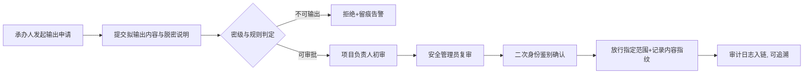
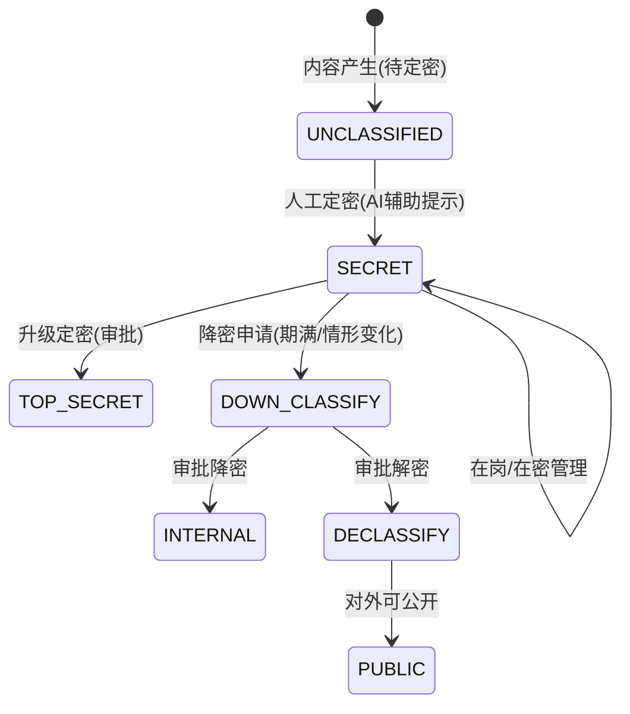

# 11 涉密管理与多法人治理（模块 X）

**代号**：X（Confidentiality & Multi-legal-entity Governance）  
**版本**：v1.1 · **日期**：2026-10-13  
**里程碑**：M2（密级与三员基线）→ M3（涉密网隔离/信息流向/并表口径信创加固）  
**上游**：`../PRODUCT_PLAN.md` L1 底座、`README` 2.12/2.13、竞品借鉴（科南 CoNow"涉密网三员/日志安全/身份鉴别/涉密信息流向控制 + 网络安全多域化 + 总院-院所两级多法人 + 信创全栈"）  
**编号前缀**：涉密事项 `SEC`、输出审批 `EXF`、法人 `LE`

---

## 1. 模块概述与目标

本模块是**横切型安全与组织治理能力**，不是独立业务闭环，而是给 P/E/F/R/T/G/A 各模块提供"密级、隔离、流向、分级授权、并表口径"的公共底座。它补齐 v1.0 的两大空白：

1. **涉密治理**——军工/安全/部分院所属涉密单位，科研事项需要按密级分级、在涉密网处理、控制信息跨网流向、执行三员分立与保密审查；
2. **多法人治理**——中科院系统、大型集团研究院普遍是"总院 + 多个独立法人研究所"的两级多法人结构，需要分级授权、主责法人登记、跨法人协同与总院合并视图。

设计目标：

1. 密级字段与可见域贯穿全部业务对象，默认最小可见、跨域默认拒绝；
2. 涉密事项仅在涉密网安全域内流转，跨网进出必须走"输出/进入审批 + 留痕 + 二次鉴别"；
3. 三员（系统/安全/审计）职责物理隔离，R-ADMIN 不再是一手遮天的超级权限；
4. 法人树 + 分级授权 + 并表口径，让总院"看得见合并、管得住跨法人"，分院"管得了自己、看得清边界"。

非目标：不做国家保密资格认定的行政流程（作为单位既有制度映射）；涉密物理网络与密码机由基础设施提供，本模块做业务侧对接与策略。

---

## 2. 用户角色与核心场景

| 角色 | 核心动作 |
|------|---------|
| R-SEC-ADMIN（安全管理员，三员之一） | 配置密级策略、授权范围、跨网流向规则 |
| R-SYS-ADMIN（系统管理员，三员之一） | 系统配置/用户/字典，**无权读涉密内容** |
| R-AUDIT-ADMIN（审计管理员，三员之一） | 稽核日志、越权与流向告警、出保密审计报告 |
| R-STAFF / R-MANAGER | 标记事项密级、发起涉密输出申请、按授权查看本密级数据 |
| R-LEADER | 总院合并视图、跨法人事项审批 |
| R-FINANCE | 分法人并表、跨法人成本/收入分摊口径 |
| R-AUDITOR | 全量只读追溯（受密级约束在授权域内） |

**核心场景**：

- 场景一（密级隔离）：某国防预研项目标 `SECRET`，其申报书、合同、成果、经费明细仅在涉密网可见；办公内网只能看到"存在该项目"的脱敏占位。
- 场景二（输出审批）：PI 需将一段非核心试验数据用于公开论文，发起"涉密输出审批"，安全管理员 + 项目负责人双审，通过后仅放行已脱敏内容并记录流向。
- 场景三（人员保密审查）：新入职涉密岗人员经保密审查与培训，获得相应密级许可；离职触发权限与载体清退。
- 场景四（多法人协同攻关）：总院牵头、A 所与 B 所（不同法人）联合项目，在主责法人 A 所登记，B 所参与人只读本所相关部分，总院看到合并经费与进度。

---

## 3. 用户故事（节选）

| ID | 用户故事 | 优先级 |
|----|---------|--------|
| US-X-01 | 作为安全管理员，我定义密级、可见域和跨网流向策略并即时生效 | P0 |
| US-X-02 | 作为科研员，涉密事项在错误的网络域访问一律被拒绝并告警 | P0 |
| US-X-03 | 作为科研员，我能发起涉密信息输出申请，走双审并全程留痕 | P0 |
| US-X-04 | 作为审计管理员，任何跨域访问/输出都有不可篡改日志可查 | P0 |
| US-X-05 | 作为系统管理员，我能配置系统但看不到涉密正文（三员分离） | P0 |
| US-X-06 | 作为总院领导，我看到跨法人项目的合并视图与分法人下钻 | P1 |
| US-X-07 | 作为财务，跨法人收入/成本按主责法人入账、参与法人按比例分摊 | P1 |
| US-X-08 | 作为安全管理员，涉密人员入职审查、在岗复审、离岗清退有流程 | P1 |
| US-X-09 | 作为 PI，AI 帮我识别文档中疑似应标密的内容并提示密级（辅助，不自动定密） | P1 |

---

## 4. 功能清单与优先级

| 功能 | 说明 | 优先级 |
|------|------|--------|
| X-01 密级体系与字段 | `PUBLIC/INTERNAL/SECRET/TOP_SECRET` 贯穿全对象，默认可见域 | P0 |
| X-02 三网安全域路由 | 按密级把单据路由/隔离到互联网/办公内网/涉密网对应域 | P0 |
| X-03 三员分立权限 | 系统/安全/审计管理员职责拆分，R-ADMIN 无法读涉密正文 | P0 |
| X-04 二次身份鉴别 | 涉密操作口令 + 硬件 Key/生物，进入涉密域强鉴别 | P0 |
| X-05 涉密信息流向控制 | 跨网下行/上行默认禁止，例外走审批 | P0 |
| X-06 涉密输出/进入审批 | 脱密输出、外部进入的审批流与留痕（EXF 单） | P0 |
| X-07 审计日志与稽核 | 字段级 diff + 数字签名 + 防篡改；越权/流向告警 | P0 |
| X-08 法人树与分级授权 | 总院—分院法人结构，ABAC 按 `legal_entity` 授权 | P0 |
| X-09 主责法人登记 | 跨法人事项登记方规则，参与法人只读边界 | P0 |
| X-10 并表口径与下钻 | 项目/经费/资产/合同的分法人汇总与总院合并 | P1 |
| X-11 涉密人员管理 | 保密审查、密级许可、在岗复审、离岗清退 | P1 |
| X-12 涉密载体与设备 | 涉密资产（联动 A）、存储介质台账与销毁 | P1 |
| X-13 **AI 疑似涉密识别** | 从文档中提示可能需定密的内容与依据（辅助人工定密） | P1 |
| X-14 密级继承与降密/解密 | 派生对象继承密级；到期降密/解密走审批 | P1 |
| X-15 信创全栈适配 | 国产 OS/DB/中间件/CPU 与密码算法（SM 系列）合规 | P0（底座） |

---

## 5. 数据模型

### 5.1 主要表

**X_LEGAL_ENTITY 法人**
```
id, code(LE-…), tenant_id, parent_id(总院→分院树形)
legal_name, credit_code, level(总院/分院), is_legal_person tinyint
account_id(法人账户→F), report_scope(并表口径)
status enum ACTIVE=正常/DEREGISTERED=注销
```

**X_SECURITY_POLICY 密级策略（制度包内）**
```
id, code, tenant_id, version, effective_from/to
matrix_json  每个 security_level 的：可见网络域、角色白名单、可否导出、可否跨网
applied_modules  [P,E,F,R,T,G,A,C,D…]
```

**X_ACCESS_GRANT 授权与密级许可**
```
id, subject_user_id, scope_type(法人/部门/项目/密级), scope_ref
granted_level   可见最高密级
network_zone    enum 互联网/办公内网/涉密网
mfa_bound       是否绑定硬件Key/生物
valid_from, valid_to, status(EFFECTIVE=生效/FROZEN=冻结/REVOKED=吊销)
```

**X_FLOW_AUDIT 跨网/输出审批（EXF）**
```
id, code(EXF-年-序), direction enum 涉密→内网/内网→互联网/互联网→内网/外→涉密
object_ref  被流转对象(项目/成果/合同/文档), payload_digest 内容指纹
desensitize_note 脱密说明
approver1(承办/项目负责人), approver2(安全管理员), second_confirm 二次鉴别结果
status enum APPLIED=申请/PRE_REVIEW=初审/SEC_REVIEW=复审/RELEASED=放行/REJECTED=驳回/RECORDED=留档   release_scope 放行范围
```

**X_SEC_LOG 安全审计日志（防篡改）**
```
id, actor_id, actor_role, legal_entity_id, network_zone
action, object_type, object_id, field_diff_json
security_level, result(允许/拒绝), risk_flag
hash_prev, hash_self  哈希链防篡改 ; occurred_at, source_ip, device_id
```

**X_PERSONNEL_SEC 涉密人员**（联动 07）
```
user_id FK, secret_eligible tinyint, granted_level, review_date(在岗复审)
training_records[], leave_clearance 离岗清退(载体/权限/承诺), status
```

### 5.2 ER 关系
```
X_LEGAL_ENTITY(树) ──< 所有业务表.legal_entity_id
X_SECURITY_POLICY ──< X_ACCESS_GRANT ──> user/role
业务对象.security_level ──> X_FLOW_AUDIT(跨网) & X_SEC_LOG(访问/拒绝)
X_PERSONNEL_SEC ──> S_STAFF(07)  ; 涉密资产 ──> A_ASSET(10)
```

---

## 6. 业务流程与状态机

### 6.1 涉密信息输出（脱密下行）



### 6.2 密级 / 降密解密状态机

> token ↔ 中文：UNCLASSIFIED=待定密 · SECRET=秘密 · TOP_SECRET=机密/绝密 · DOWN_CLASSIFY=降密申请 · INTERNAL=内部 · DECLASSIFY=解密 · PUBLIC=公开（可对外）。密级取值集合与 `README 2.13` 安全域一致。

### 6.3 三网访问判定
```
请求 → 取对象 security_level → 查 X_SECURITY_POLICY 可见域
   → 判断当前 network_zone ∈ 可见域?
       否 → 拒绝 + 写 X_SEC_LOG(risk_flag)
       是 → 校验 actor.granted_level ≥ object.level
             且 MFA 达标 → 放行(字段级)
```

---

## 7. 界面与交互原型

**7.1 法人治理树 `/governance/entity`**：总院—分院树形；每法人显示项目数/经费/资产/人员与并表口径；主责法人标注。

**7.2 合并看板 `/governance/consolidate`**：总院领导视图，全院合并指标 + 分法人下钻；跨法人项目单独列示。

**7.3 密级与授权 `/security/policy`（安全管理员）**：密级×网络域×角色可见性矩阵编辑器（版本化制度包）；人员密级许可授予与冻结。

**7.4 涉密输出审批 `/security/export`（EXF）**：申请—双审—二次鉴别—放行留痕；内容指纹比对防篡改。

**7.5 安全审计 `/security/audit`（审计管理员）**：跨域访问/拒绝/输出事件流；哈希链校验；一键出保密审计报告。

> prototype 中涉密能力以"密级徽标 + 跨域拒绝提示 + 输出审批卡片"的形态分散呈现，不单独整屏（避免涉密信息在演示环境出现）。

---

## 8. AI 能力详规（八要素见 `README 2.4`）

### 8.1 X-13 AI 疑似涉密识别
- 触发点：申报书/合同/成果/文档提交或下载前。
- 输入：文本 + 单位脱密规则关键词 + 项目背景。
- 输出：提示"以下内容疑似涉密（军工型号/坐标/参数），建议人工定密复核"，给出片段与建议密级。
- 铁律：**AI 绝不自动定密、绝不自动降密**；仅提示，决定权在人。
- 可解释性：命中关键词/规则编号。
- 置信度与兜底：一律人工确认；低置信不拦截只提示。
- 评估：漏报率优先（宁可误报），误报率控制；反馈定密结果回流。
- 边界：涉密网内模型须本地部署（信创），不外传涉密语料。

---

## 9. 权限矩阵（三员分立，遵循 `README 2.13`）

| 能力 | 系统管理员 | 安全管理员 | 审计管理员 | R-LEADER | R-AUDITOR |
|------|-----------|-----------|-----------|----------|-----------|
| 用户/字典/系统配置 | ● | 读 | 读 | | |
| 密级策略/授权/流向规则 | 无 | ● | 读 | 审批 | 读 |
| 查看涉密正文 | **无权** | 按其密级许可 | 无权(仅元数据/日志) | 按其密级许可 | 授权域内读 |
| 审计日志/告警 | 无(不可删改) | 读 | ● 稽核 | 读 | 读 |
| 法人树/并表口径 | 配置 | 授权 | 读 | ● | 读 |

原则：**配置的人看不到内容，看内容的人改不了策略，改策略的人删不了日志**。跨法人数据按 `legal_entity` ABAC 隔离（`README 2.12`）。

---

## 10. 接口清单（节选）

- `GET/POST /api/v1/governance/entity` 法人树；`GET /api/v1/governance/consolidate?level=合并`
- `POST /api/v1/security/policy` 发布密级策略版本；`GET /api/v1/security/policy/current`
- `POST /api/v1/security/grant` 授权/密级许可；`/revoke`
- `POST /api/v1/security/export` 发起输出审批；`/approve`；`/release`（二次鉴别）
- `POST /api/v1/security/classify` 密级判定/降密/解密申请
- `POST /api/v1/security/log` 内部埋点写入哈希链；`GET /api/v1/security/log?risk=true`
- `POST /api/v1/security/personnel/review` 涉密人员审查/清退
- 网关侧：`zone-guard` 依据 `security_level × network_zone × granted_level` 前置放行/拒绝

内部依赖：所有业务模块对象需带 `security_level`/`legal_entity_id`；A（涉密资产）、F（并表口径）、07（人员许可）、D（合并看板）。

---

## 11. 异常处理与边界场景

- **跨域越权访问**：任何 `zone` 与 `security_level` 不匹配访问 → 拒绝 + risk 告警 + 审计，且对本人不暴露对象细节（防探测）。
- **AI 误判定密**：定密/降密永远人工，AI 提示仅参考；未定密内容默认按 INTERNAL 保守处理。
- **三员兼任**：策略禁止同一账号兼任两员；发现兼任立即冻结并告警。
- **日志被篡改企图**：哈希链断裂即触发最高级安全告警并只读取证模式。
- **脱密输出内容不符**：放行按内容指纹，若实际输出与审批指纹不一致，二次拦截。
- **多法人重复统计**：并表以主责法人为准，参与法人按分摊口径，避免收入/资产重复计入合并值。
- **人员离岗未清退**：离职流程强制联动涉密载体与权限清退，未完成则权限自动收敛为只读占位。
- **信创环境降级**：非信创环境禁用涉密模块并灰化入口，避免在不合规栈处理涉密数据。

---

## 12. 验收标准与非功能需求

**功能**：密级、法人、三员、流向四要素在抽样业务对象上端到端生效；跨域拒绝准确率 100%；输出审批闭环可追溯。

**安全**：三员职责隔离；涉密正文对系统/审计管理员不可见（除非其密级许可）；审计日志防篡改（哈希链校验通过）；二次身份鉴别强制。

**性能**：网关密级/域判定 < 50ms 增加延迟；并表查询 < 1s（预聚合）；审计写入不影响主流程（异步链）。

**合规**：满足保守国家秘密法、涉密信息系统分级保护（BMB 相关）、等保三级；全栈信创与国产密码算法（SM2/SM3/SM4）；支持但不绑定底层技术栈（对齐 CoNow"信创化/不绑定 WinTel"）。

**可交付性**：非涉密单位可整体关闭 X 涉密子能力，仅保留多法人治理；多法人可退化为单法人模式，保证中小院所开箱即用。
