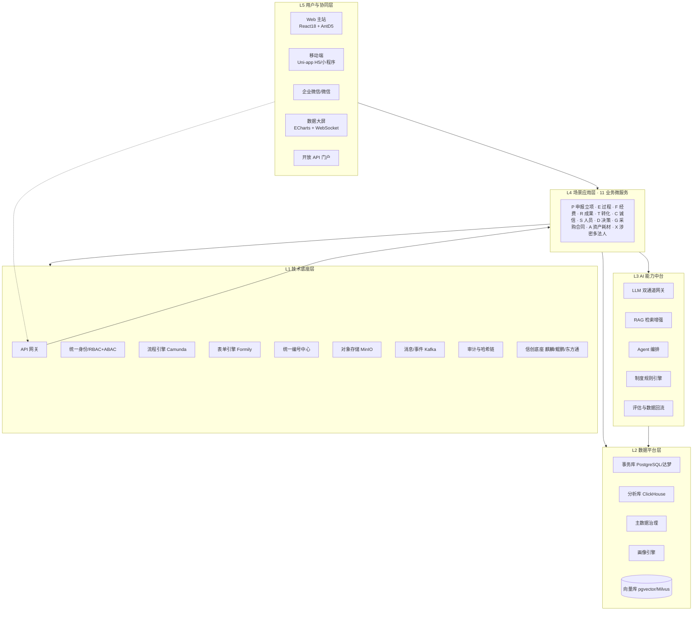
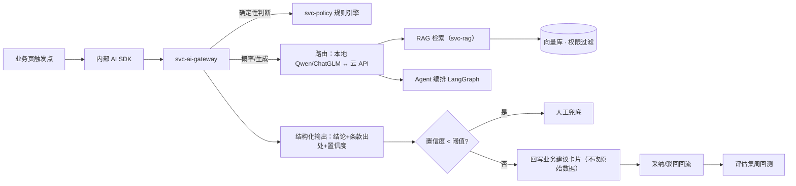
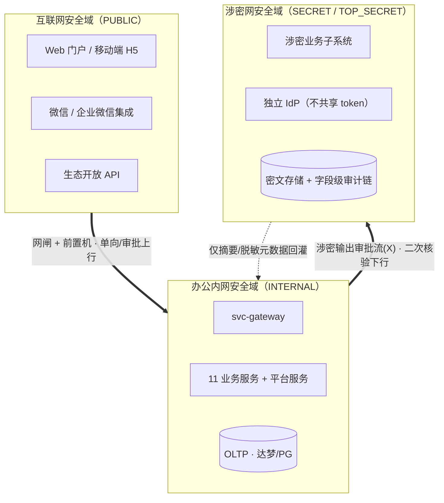
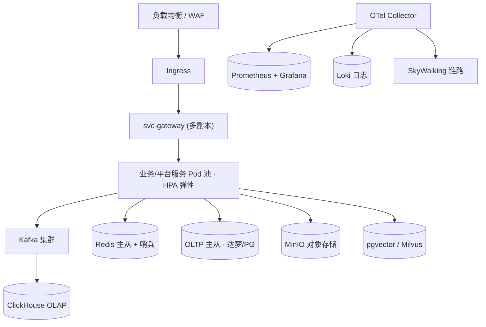
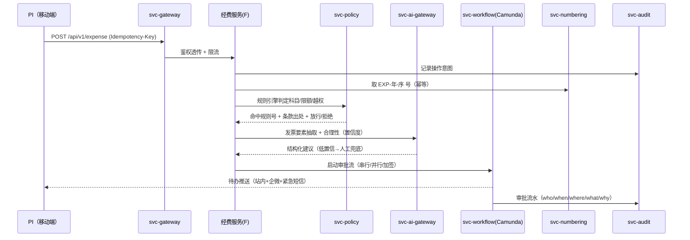

# 科研管理系统 · 架构与技术方案

**版本**：v1.0 · **日期**：2026-10-13
**上游文档**：`./PRODUCT_PLAN.md`（产品规划 v1.1）、`./PRD/README.md`（PRD 通用规约 v1.1）及 01–11 模块 PRD
**读者对象**：架构师、后端/前端/AI 工程师、运维/SRE、安全合规、项目管理者
**目标**：把产品规划的五层架构与 11 个业务模块，落地为可实现、可部署、可过等保三级与信创测评的技术方案；并逐条映射 PRD 通用规约（README 2.1–2.15）到具体技术组件。

> 术语与约定一律以 `PRD/README.md` 为准：角色 `R-*`、表名前缀 `P_/E_/F_/R_/T_/C_/S_/D_/G_/A_/X_`、单号前缀见 2.11 注册表、状态用大写蛇形 token（2.6）、密级 `PUBLIC/INTERNAL/SECRET/TOP_SECRET`（2.13）。本文不重复定义，只引用与实现。

---

## 一、架构总览

沿用产品规划的五层分层，给出运行视图。上层只向下依赖，跨层调用统一经 API 网关与服务契约。

设计要点：业务服务（L4）与 AI 中台（L3）解耦——业务通过内部 SDK 调用 `svc-ai-gateway`，AI 永不直接写业务库，只回吐结构化建议，符合 PRD 2.4「AI 不得直接改写用户已提交数据、不得作为唯一决策依据通过审批」。确定性合规（金额/限额/越权）走 `svc-policy` 规则引擎，概率性判断（发票/合同风险/起草）走 `svc-rag`+LLM，二者边界见 PRD 2.10 分工表。

---

## 二、技术选型（决策表）

与 `PRODUCT_PLAN` 第八/九章对齐，并给出选型理由、备选与信创替代路径。

| 领域 | 主选 | 备选 | 理由 | 信创替代 |
|------|------|------|------|----------|
| 后端语言/框架 | Java 17 + Spring Cloud Alibaba | Go + Kratos | 生态成熟、流程/规则引擎与国产化适配案例多，团队可招聘 | 全栈可运行于麒麟 + 鲲鹏/海光 |
| 微服务治理 | Nacos + Sentinel + OpenFeign | Consul | 注册/配置/熔断一体，阿里系与信创兼容 | 东方通中间件承载 |
| 流程引擎 | Camunda 7（BPMN 2.0） | Flowable | 可视化编排、子流程、事件网关；对齐竞品"三引擎"卖点 | 无锁定，纯 Java |
| 表单引擎 | Formily 2（JSON Schema） | 自研 | 字段级校验/联动/条件显隐；字段可带自然语言描述供 LLM 理解（AI 原生前提） | 同左 |
| 事务数据库 | PostgreSQL 16 | 达梦 DM8 / 人大金仓 / OceanBase | JSONB、pgvector、强约束；兼容性优于 MySQL | 达梦/金仓为主投路径，SQL 方言经 MyBatis 层屏蔽 |
| 分析数据库 | ClickHouse | Apache Doris | 大屏/画像/趋势高吞吐聚合 | Doris（国产）可选 |
| 缓存/号段 | Redis 7 | 华为 DCS | 编号中心双写、会话、限流 | 兼容 |
| 对象存储 | MinIO | 阿里云 OSS | 附件 ≤100MB、在线预览；S3 兼容可私有化 | MinIO 国产化部署 |
| 消息/事件 | Apache Kafka | RocketMQ | 业务事件、数据回流、审计流总线 | RocketMQ（阿里/信创友好） |
| 规则引擎 | Drools 8 | 自研 DSL | 制度包版本化、可解释、命中留痕 | 纯 Java 无锁定 |
| 向量检索 | pgvector（起步） | Milvus | 起步用 PostgreSQL 扩展降低运维，规模化再迁 Milvus | Milvus 可私有化 |
| Embedding | BGE-M3 | m3e | 中英混合、长文档；可本地推理 | 本地部署 |
| LLM | 本地 Qwen2.5-14B/ChatGLM | 通义/文心/DeepSeek 云 API | 信创/涉密严格本地；非涉密复杂任务经用户授权走云端 | 强制本地化 |
| Agent 编排 | LangGraph | AutoGen | 多步任务（如"起草申报书"）图式编排 | 本地运行 |
| AI 评估 | LangSmith | 自研评估平台 | 每能力独立评估集、周回测 | 自研可离线 |
| 前端 | React 18 + TypeScript + Vite | Vue 3 | 组件生态、复杂表单/大屏 | 同左 |
| 图表 | ECharts 5 + vis.js | AntV | 大屏与关系网络（PI 合作图谱） | 同左 |
| 富文本 | TipTap（结构化 schema） | — | 申报书撰写可被 LLM 解析 | 同左 |
| 移动端 | Uni-app（一套多端） | 原生 | H5/小程序/App 复用，满足 PRD 2.14 移动审批 | 微信小程序 + 国产 ROM |
| 容器编排 | Kubernetes + Helm | Docker Compose（灯塔试点） | 多环境、灰度、弹性 | 国产 K8s（如 Rancher/KubeSphere） |
| 可观测 | OpenTelemetry + Prometheus + Grafana + Loki + SkyWalking | — | 统一 `traceId` 贯穿（PRD 2.5） | 同左 |

---

## 三、服务拆分

按"业务服务 + 平台服务"两类拆分，边界与 PRD 模块 1:1 对应，便于各模块 PRD 直接映射到服务与接口清单。所有对外 REST 遵循 PRD 2.5 路径 `/api/{version}/{module}/{resource}`、统一响应 `{ code, message, data, traceId, timestamp }`、JWT + Refresh、`Idempotency-Key` 幂等、限流（普通 100 req/min、AI 20 req/min）。

### 3.1 业务微服务（11）

| 服务 | 模块代号 | 覆盖 PRD | 主要职责 |
|------|----------|----------|----------|
| svc-application | P | 01 | 指南、申报书、立项、备案查重、横向立项、任务书解析 |
| svc-project-process | E | 02 | 里程碑、中检/结题、变更、健康分、归档清单校验、双向追溯 |
| svc-finance | F | 03 | 预算、报销、凭证同步、外拨经费、全成本、平行记账、执行预测 |
| svc-output | R | 04 | 成果登记/认领、查重、影响力、报送 |
| svc-transfer | T | 05 | 披露、评估、谈判、签约、到账、分配 |
| svc-integrity | C | 06 | 承诺、失信档案、不端检测、伦理（IRB） |
| svc-people | S | 07 | 人员、团队、PI 画像、学生/访问者、人才计划 |
| svc-analytics | D | 08 | 指标、报表、大屏、NL2SQL、报送模板库、订阅 |
| svc-procurement | G | 09 | 采购申请、判定、招标比价、合同、付款计划、供应商/外协库、到货转资产 |
| svc-asset | A | 10 | 资产卡、耗材库存、折旧、领用/处置、成本分摊、共享仪器 |
| svc-security | X | 11 | 密级、三网路由、三员、信息流向审批、法人树与分级授权 |

服务间协作示例：`G →(到货)→ A` 生成资产卡（G-17/A-03）；`F-22 外拨 ↔ G-09 外协合同 ↔ E-16 外协`；`A-12 成本分摊 → F-20 全成本`；`D-19 多法人合并视图 ← X 法人树`。这类跨模块动作以领域事件（Kafka）异步编排 +  Saga 补偿，避免跨库强事务。

### 3.2 平台服务（横切）

| 服务 | 承载的 PRD 规约 | 职责 |
|------|-----------------|------|
| svc-gateway | 2.5 | 路由、认证前置、限流、`traceId` 注入、安全域路由判定 |
| svc-identity (IAM) | 2.1 / 2.12 / 2.13 | 统一登录 CAS/OAuth2、RBAC+ABAC（含 `legal_entity` 属性）、涉密网独立 IdP、三员账号隔离、MFA |
| svc-workflow | 2.3 / 2.14 | Camunda 审批流：撤回/驳回/加签/转办/并行串行；移动端审批任务推送 |
| svc-form | 2.8 / L1 | Formily 动态表单 + `sys_dict` 数据字典驱动，字段带 NL 描述 |
| svc-policy | 2.10 | Drools 规则引擎 + 制度包 `sys_policy_pack` 版本化，命中留痕 `policy_pack_id` |
| svc-numbering | 2.11 | 统一编号中心（前缀注册表 + Redis/DB 双写 + 法人短码分号段） |
| svc-ai-gateway | 2.4 / 九 | LLM 双通道路由（本地/云）、Prompt/Token 治理、可解释输出、置信度阈值兜底 |
| svc-rag | 九 | 政策/申报书/评审/成果语料向量化与检索（权限隔离过滤） |
| svc-file | 2.3 | 对象存储、格式白名单、在线预览、病毒扫描 |
| svc-print | 2.14 | 红头/表格套打模板 `sys_print_template`、PDF 生成、回填、归档一致性（→ E-05） |
| svc-notify | 2.3 | 站内/企微/邮件/短信四级通知、紧急走短信 |
| svc-audit | 2.13 / 2.9 | 字段级 diff 审计、数字签名、不可篡改哈希链、导出 |
| svc-mdm | 2.15 / L2 | 人员/项目/成果/机构/科目五大主数据单一事实来源 |
| svc-openapi | D-17 / 2.5 | 数据资产开放 API、对外报送接口 |
| svc-integration | 九 | 财务（用友/金蝶）、OA（泛微/致远）、WoS/CNKI、第三方 CA、电子卖场适配器 |

---

## 四、横切平台能力 ↔ PRD 规约映射

这是本方案的关键约束层，逐条把 README 2.10–2.15 落成实现：

- **制度规则引擎与确定性合规（2.10）**：`svc-policy` 加载 `sys_policy_pack(code,name,effective_from,to,dsl_yaml,applied_modules[])`，业务单据落地时写入所用 `policy_pack_id` 快照供事后复算。金额阈值、招投标限额（100 万以上强制公开招标等）、包干制/预算制科目约束、审批越权一律走规则引擎并输出"命中规则号 + 出处条款 + 拒绝/放行原因"；发票合理性、合同风险表述走 LLM（附置信度，低于阈值回落人工）。采购（G）与经费（F）共用同一套限额规则包，避免口径漂移。
- **统一编号中心（2.11）**：`svc-numbering` 是唯一取号入口，业务服务不得自造号。号段维度 = `tenant + 前缀 + 分法人`，跨法人事项走总院号段。作废不回收、重试幂等。前缀集合以 2.11 注册表为唯一来源（新增前缀先登记再实现）。
- **多法人治理与分级授权（2.12）**：数据以 `tenant_id`（总院法人边界）+ `legal_entity_id`（法人细分）双键隔离；ABAC 决策属性加入 `legal_entity`。总院可看全集团/批跨法人事项，分院只看本法人及下属。跨法人项目在主责法人入账并表，参与法人按比例下钻汇总给总院合并视图（`D-19`）。组织树 `ORG` 支持总院法人/分院法人/非法人部门三类节点。
- **安全域与三员（2.13）**：见第七章安全架构。核心：`security_level ∈ {PUBLIC,INTERNAL,SECRET,TOP_SECRET}` 参与每次读写的网关与数据层双重过滤；三网物理/逻辑隔离 + 网闸前置机；系统/安全/审计三员账号物理隔离、禁止兼任。
- **移动审批与套打（2.14）**：所有含审批流的服务（P/E/F/R/T/G/A/C/X）向 `svc-workflow` 注册移动任务；`svc-print` 提供套打模板与 PDF，输出自动归档到项目档案（E-05）并绑定结构化版本号。
- **免表与数据反哺（2.15）**：`svc-mdm` 保证关键字段 Owner 唯一、他处只读引用；新增单据从主数据+历史版本自动带入；报送类表格字段必须可从库直接抽取生成（R-18/D-07/D-08）；`svc-analytics` 的画像/预警回流到业务页（PI 画像入项目详情、健康分入审批页）。

---

## 五、数据架构

### 5.1 存储分层

事务数据落 PostgreSQL（或信创达梦/金仓），分析/画像/大屏走 ClickHouse，通过 CDC（Debezium）或业务事件准实时同步，形成 OLTP→OLAP 单向数据流，避免大屏重查询拖垮交易库。附件走 MinIO，元数据与权限走事务库。向量数据起步用 pgvector，规模化迁 Milvus。缓存/号段/限流走 Redis。

### 5.2 建模约定

所有业务表默认含 PRD 2.2 通用字段（`id/code/tenant_id/status/deleted/creator_id/modifier_id/created_at/updated_at/remark`）；金额统一 `DECIMAL(18,2)`；日期 `DATETIME`（Asia/Shanghai）。表名前缀按模块（`G_CONTRACT`、`A_ASSET`、`X_LEGAL_ENTITY` 等）与单号前缀（`CON/AST/LE`…）是两套体系，互不混用。软删用 `deleted`，物理隔离靠 `tenant_id + legal_entity_id + security_level` 复合过滤。DDL 由各模块 PRD 第 5 节聚合生成（后续「汇总数据库设计」交付物承接）。

### 5.3 主数据与一致性

人员、项目、成果、机构、科目五大主数据由 `svc-mdm` 治理，其余模块引用。跨模块写入用领域事件 + Saga 最终一致（如报销入账→成本池→全成本分摊），单库内保持强一致。

---

## 六、AI 能力中台架构

约束：每个 AI 能力必须满足 PRD 2.4 八要素（触发点/输入/输出格式/可解释/置信度/人工兜底/评估指标/数据回流）；涉密与信创环境强制走本地模型且 RAG 语料按 `security_level + legal_entity` 过滤；AI 只产建议不写业务数据；审批链不因单一 AI 判断自动通过。LLM 部署：院内 7B–14B 本地默认，复杂推理经用户批准调用云端。

---

## 七、安全架构与多法人治理

安全设计直接落地 PRD 2.12（多法人分级授权）与 2.13（安全域与三员管理）。核心是**三张物理/逻辑隔离的网络域**，业务代码不感知网闸，跨域一律走前置机 + 涉密输出审批流。

访问控制采用 **RBAC + ABAC 双层**，ABAC 判定键为 `tenant_id + legal_entity_id + security_level`（外加部门、PI、时段）。`tenant_id` 对应一个总院法人边界，法人内部按 `legal_entity_id` 细分；涉密对象仅在对应安全域内可读，跨域读写受上图中箭头方向与审批流约束。三员（系统管理员 / 安全管理员 / 审计管理员）在 IAM 中拆成三个物理隔离账号，禁止兼任，R-ADMIN 的能力按配置、授权、稽核三权分立落库。关键操作（定密/解密、涉密输出、大额支付、跨法人并表）强制二次身份鉴别（口令 + 硬件 Key），审计链为"字段级 diff + 数字签名 + 不可篡改"。

---

## 八、集成架构

系统需与院所既有信息化生态对接，统一走 `svc-integration` 适配层，对外协议以 REST/事件为主，Legacy 系统经 CDC 或批量文件桥接。所有对外接口在 `svc-openapi` 注册并遵循 PRD 2.5 API 规约。

| 对接方向 | 对端系统 | 协议/方式 | 数据对象 | 归属服务 | 一致性 |
|----------|----------|-----------|----------|----------|--------|
| 出 | 财务核算系统（用友/浪潮/政府会计平台） | REST + 对账文件 | 凭证、报销、到账、平行记账 | svc-integration/fin | Saga + 日终对账 |
| 出 | 银行 / 国库集中支付 | 银企直连 / 文件 | 到账流水、支付回执 | svc-integration/bank | 幂等 + 对账 |
| 入 | 人事 / 组织主数据（HR） | CDC / 定时拉取 | 人员、部门、法人、职称 | svc-mdm | 最终一致 |
| 入 | 文献 / 期刊数据（知网/WoS/Scopus） | API / 检索 | 成果、影响因子、分区 | svc-integration/pub | 每日增量 |
| 入 | 税务 / 发票查验平台 | API | 发票要素、验真结果 | svc-integration/tax | 同步调用 |
| 出 | 电子签章 / 第三方 CA | API | 合同签署、用印流水 | svc-integration/seal | 回调 + 状态机 |
| 出 | 上级报送 / 学科评估 | 模板导出 | 年度报送、评估数据 | svc-openapi | 免表抽取生成 |
| 入 | OA / 企业微信 / 钉钉 | Webhook | 待办、审批、消息 | svc-notify | 事件驱动 |
| 出 | 物联网 / 门禁 / 视频（资产、危化品） | MQTT | 领用、称重、定位 | svc-integration/iot | 事件流 |

跨模块强一致诉求（如 `G_ORDER 到货 → A_ASSET 建卡`、`F-22 外拨 ↔ G-09 外协合同 ↔ E-16 项目节点`、`A-12 折旧 → F-20 全成本分摊`）统一用 **Kafka 事件 + Saga** 编排，落 `policy_pack_id` 快照供事后复算；本地事务表 + 补偿任务保证不重不漏。

---

## 九、部署拓扑与环境

平台化部署基于 Kubernetes + Helm，信创环境替换为国产底座（麒麟/统信 OS、达梦/金仓、东方通/宝兰德、鲲鹏/海光），应用层无感知。

环境划分为 **DEV / SIT / UAT / 生产**四套，配置与密钥走独立配置中心，生产禁止直连调试。涉密子系统独立部署于涉密网 K8s 集群，与办公内网集群物理隔离、镜像与模型工件离线分发。备份策略：OLTP 每日全量 + 实时 WAL 归档，对象存储跨副本，ClickHouse 冷热分层。容灾目标见 §十一。

---

## 十、典型请求链路（报销提交为例）

全链路携带 `traceId`，任何拒绝都回传可读理由与依据条款，满足 PRD 2.9 审计留痕验收项。

---

## 十一、可观测性与运维

统一以 OpenTelemetry 采集 trace/metric/log，Prometheus + Grafana 做指标与告警，Loki 聚合日志，SkyWalking 做跨服务链路追踪。黄金指标覆盖：接口 P95 延迟、错误率、流程引擎任务积压、LLM 首字节时延与采纳率、编号服务取号 TPS、跨域审批流时长。

SLI/SLO 基线：列表查询 P95 < 500ms、1 万条导出 < 30s、AI 首字节 < 2s、核心写接口可用性 99.9%；生产 RPO ≤ 5min、RTO ≤ 30min（涉密子系统按等保三级另行收紧）。告警分级路由到值班，重大事件走短信。灰度发布用金丝雀 + 特性开关（制度包版本切换即时生效并保留历史快照）。

---

## 十二、非功能需求映射

| 维度 | 目标 | 架构手段 |
|------|------|----------|
| 性能 | 列表 P95<500ms，导出 1w<30s | 读写分离、OLAP 列存、分页上限 200、异步导出 |
| 可用性 | 核心 99.9% | 多副本 + HPA + 熔断降级 + 主从自动切换 |
| 可扩展 | 12 模块独立演进 | 微服务拆分、事件解耦、契约先行 API |
| 安全合规 | 等保三级 / 涉密分级 | 三网隔离、三员分立、字段级审计、二次鉴别 |
| 信创 | 全栈国产化可交付 | 抽象层屏蔽差异，达梦/麒麟/东方通替换 |
| 可审计 | 全动作可复算 | policy_pack_id 快照 + 编号幂等 + 审批流水 |
| AI 可控 | 不自动决策 | 置信度阈值 + 人工兜底 + 只产建议不改数据 |
| 数据一致 | 跨模块不重不漏 | Kafka + Saga + 本地事务表 + 对账 |

---

## 十三、演进路线与架构交付对齐

架构能力随 PRD 三阶段路线图分批打底，避免 M1 范围失控。

| 阶段 | 架构交付 | 支撑的 PRD 模块 | 说明 |
|------|----------|-----------------|------|
| M1（1-4月） | L1 底座（网关/IAM/流程/表单/编号/审计）+ 规则引擎 + P/E/F/R/T/S/D/G/A 核心服务 | 01-04、06-07、09-10 的 P0 | 电子签章仅对接 1 家 CA，外协库先最小模型；移动审批与套打 M2 跟进 |
| M2（5-8月） | AI 中台（网关/RAG/Agent/评估）+ 移动端 + 数据大屏 + 微信集成 | 各模块 P1、08 起步 | 落地 4-6 个高频 AI 场景，试点扩展至 3 家 |
| M3（9-12月） | L2 数据平台（数仓/治理/画像引擎）+ 信创全套 + 开放 API + 涉密多法人 | 08/11 的 P2 | 通过信创测评，涉密子系统独立部署，产品规模化复制 |

架构前置约束：制度包版本化、统一编号中心、多法人 `legal_entity_id` 与三网 `security_level` 三字段在 M1 即进入数据模型底座，后续模块只引用不重造，确保全生命周期可追溯。

---

## 十四、架构决策记录（ADR 摘要）

- **ADR-001 · 规则引擎与 LLM 分工**：确定性合规（金额/限额/越权/科目）走 Drools 规则引擎并落 `policy_pack_id`，LLM 仅承担理解/抽取/生成；理由是合规判断必须可解释、可复算、可审计（PRD 2.10）。
- **ADR-002 · 微服务而非单体**：按业务域拆 11 服务 + 平台能力下沉，换取独立演进与伸缩；代价是分布式事务复杂度，以 Saga + 事件补偿消化。
- **ADR-003 · OLTP 与 OLAP 双引擎**：交易走达梦/PG，分析走 ClickHouse，经 CDC 同步；避免大屏/画像查询压垮生产库。
- **ADR-004 · 统一编号中心**：所有业务编号集中由 svc-numbering 幂等取号，杜绝并发重号与模块各自命名漂移；表名前缀与单号前缀分属两套体系（PRD 2.11）。
- **ADR-005 · 状态以大写蛇形 token 为准**：持久态权威值为 token，中文仅作 `TOKEN=中文` 映射，stateDiagram 节点取 token；统一 API/事件/状态机语义（PRD 2.6）。
- **ADR-006 · LLM 本地默认 + 云端可选**：院内 7B–14B 本地模型为默认，复杂推理经用户批准才调用云端；涉密与信创环境强制本地且 RAG 按域过滤，兼顾能力与数据不出域。
- **ADR-007 · 三网物理隔离 + 独立 IdP**：涉密网独立身份与存储，跨域走网闸+前置机+审批流，应用不感知网络边界；以最小信任与全链路留痕满足分级保护。

---

## 待决问题与风险

1. **M1 范围偏大**：基本功 P0（横向合同、电子签章、外协外拨、归档校验、成果闭环、绩效分配）叠加底座，需做减法保时间线——签章 M1 限 1 家 CA、外协库最小模型，移动端与套打延至 M2。
2. **多法人并表口径**：总院合并报表与分院下钻的分录映射规则依赖财务系统对账方案，详细设计前需与试点客户确认《政府会计制度》平行记账细则。
3. **信创性能基线未定**：达梦 + 鲲鹏组合下 OLAP 与向量检索性能待压测，可能需要为 M3 数据平台预留调优窗口。
4. **涉密测评周期长**：等保/分级测评通常滞后于开发，涉密子系统独立部署与离线模型分发需在 M2 即启动合规准备，避免 M3 卡点。
5. **成果/人员单号前缀尚未定稿**：R/S 模块当前仅声明通用 `code`，其单号前缀须在详细设计定稿前先入 2.11 注册表，防止各模块自行命名导致规则漂移。
