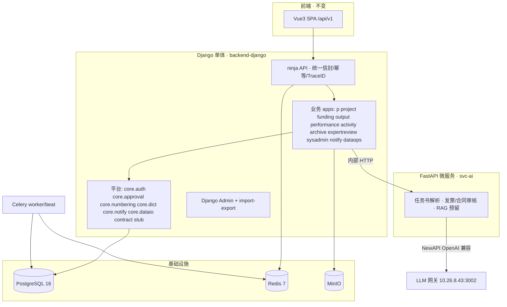

# 后端重写计划（PLAN）：Go+Gin / Node → Django 全栈重写

**日期**：2026-10-17
**决策依据**：资料库文档《科研管理系统后端技术选型-Django-vs-FastAPI》（2026-10-17）
**选型结论**：**方案 C —— Django 主体（业务/Admin/审批流/报表/集成）+ FastAPI AI 微服务**
**上游文档**：`PRD/README.md`（v1.1 通用规约）、`PRODUCT_PLAN.md`、`design/*.openapi.yaml`（16 域契约 + 00-common DDL）
**工作流**：superpowers（brainstorm → design → plan → TDD → review → finish）

---

## 一、背景与目标

当前仓库存在**三个后端形态**，架构与选型已经历两次漂移（Node mock → Go+Gin 契约直替 → 现拟 Django 重写）：

| 形态 | 位置 | 规模 | 现状 |
|------|------|------|------|
| Node 契约 mock | `backend/` | 9 个 JS 文件，约 1533 行 | 早已退出编排（见 docker-compose 注释），无鉴权，仅作契约测试夹具 |
| Go+Gin 实现 | `backend-go/` | 253 个 Go 文件，约 31k 行业务 + 7.8k 行测试 | 当前主力：12 个业务模块 + 10 个平台组件，15 个迁移，43+ 张表 |
| Django（目标） | `backend-django/`（新建） | — | 本次重写目标，按资料库选型文档方案 C 落地 |

**重写目标**：

1. 以 `backend-go/` 已验证的业务语义（状态机、审批流、幂等、降级、冒烟）为**功能基线**，用 Django 技术栈完整重写全部已实现功能；
2. 以 `design/` 16 份 OpenAPI 契约为**接口真源**，保持前端（Vue3，`/api/v1`）**零改动或最小改动**兼容；
3. 将 Go 版"契约 passthrough 兜底"升级为**契约测试驱动**的分层实现策略；
4. 为 PRD 全量 11+ 模块（P/E/F/R/T/C/S/D/G/A/X/U/V/M/N/O）预留 app 骨架，按 Phase 渐进补全；
5. AI/LLM 能力按方案 C 拆独立 FastAPI 微服务，业务 Django 不携带重 AI 依赖。

**非目标（本期不做）**：ClickHouse 分析库、Kafka 事件总线、Camunda 外挂流程引擎、K8s 编排（沿用"简单优先"，见选型文档"业务形态匹配"结论）。

---

## 二、现状盘点（重写的功能基线）

### 2.1 Go 后端已实现模块（`backend-go/internal/modules/`）

| 模块 | 契约域 | 功能 | 数据表（主） |
|------|--------|------|--------------|
| `p` | P 申报立项 | 指南、申报书、任务书 PDF/LLM 解析 | p_guideline / p_application / p_task_book |
| `project` | E 项目过程 | 立项、里程碑、变更、申报计划、分类、任务书、分类日期预警 | E_PROJECT / E_TASK / E_MILESTONE / E_CHANGE_REQUEST |
| `funding` | F 经费 | 预算、报销、收入、拨出、结转、间接费、科目管理、AI 发票审核 | F_BUDGET / F_EXPENSE / F_INCOME / F_OUTWARD / F_CARRYOVER |
| `output` | R 成果 | 论文/专利登记、认领、治理 | R_OUTPUT / R_PATENT / R_JOURNAL |
| `performance` | M 绩效 | 方案、记录、画像 | m_scheme / m_record / m_portrait |
| `activity` | V 学术活动 | 活动、参与人、评审 | v_activity / v_activity_participant |
| `archive` | O 档案 | 文档、归档、借阅（MinIO 唯一持有者） | o_document / o_archive |
| `expertreview` | N 专家评审 | 专家库、评审任务、回写 E/R（单一写者） | n_expert / n_review_task |
| `sysadmin` | U 系统管理 | 字典、角色目录、页面可见性矩阵、管理员 | sys_dict / sys_role / page_grant |
| `notify` | NF 通知 | 站内通知、导入日志、异步任务 | sys_notification / sys_import_log |
| `dataio` | 横切 | Excel 导入导出底座 | （配合 sys_import_log） |
| `dataops` | D 决策 | 大屏经费真聚合 | （聚合视图） |

### 2.2 Go 平台层（`backend-go/internal/platform/`，Django 必须逐项对等）

| Go 组件 | 语义 | Django 对等（详见 spec） |
|---------|------|--------------------------|
| `auth`（JWT + Casbin） | `/auth/login`、`/auth/me`、caps、`policy.csv` 静态门禁 | django-ninja auth bearer + JWT（对齐 claims）+ casbin-py（复用同一 model/policy 文件） |
| `middleware.Idempotency` | 写方法幂等键 → Redis 快照 TTL 24h | ninja 操作前中间件 + Redis，行为逐字节对齐 |
| `httpx` | 统一信封 `{code,message,data,traceId}`、错误码 | ninja 自定义 renderer + ApiError 体系 |
| `approval`（两级审核） | `platform.approval`：PENDING→(APPROVE/REJECT)→终态，approval_log 留痕 | Django app `core.approval` + `sys_approval_log` |
| `llm` | NewAPI OpenAI 兼容客户端；未配置时 AI 端点**自动降级**（如 REVIEW）不阻塞业务 | httpx AsyncClient 客户端 + 同语义降级开关 |
| `storage` | MinIO S3 对象存储（archive 模块持有） | django-storages[S3] |
| `oapi` + passthrough | 未手工实现端点按契约返回合规响应（保证前端全站可用） | **契约 stub 层**：未实现端点返回契约合规的占位响应（见 §5.3） |
| `migrate` | golang-migrate 拥有 schema | Django migrations 成为 schema 唯一真源 |
| `seeddemo` | 空库 DEMO- 前缀演示数据，幂等 | management command `seed_demo` |
| `httpx.TraceID` | X-Trace-Id 贯穿 | 中间件 + structlog/loguru |

### 2.3 契约与数据模型真源

- `design/*.openapi.yaml`：16 个业务域 + 12-U，共约 400+ operation，是前后端唯一契约；
- `design/00-common.sql` + `backend-go/migrations/000001~000015`：43+ 张表（sys/e_trace/p/E/F/R/T/C/S/D/G/A/X/v/m/n/o 前缀），含编号中心（`seq_prefix_registry`/`seq_allocation`）、制度包（`sys_policy_pack`）、审计（`sys_audit_log`）；
- `PRD/README.md` 2.1–2.15：角色 R-*、状态 token、编号前缀、规则引擎与 LLM 分工、多法人、三员等全局规约。

### 2.4 前端现状（兼容约束）

Vue3 + Vite，直连 `/api/v1`，依赖：统一信封、`/auth/*`、caps 字段、页面可见性矩阵（page_grant 在线配置）、错误码语义；另维护 6 个 `smoke-*.mjs` 冒烟脚本。**重写后前端必须零改动可跑**。

---

## 三、选型决策（对照资料库文档）

| 决策项 | 结论 | 理由（引用选型文档结论） |
|--------|------|--------------------------|
| 业务主体框架 | **Django 5.x LTS** | 重表单/重后台/重审批/低并发管理系统是 Django 主场；Admin+import-export 覆盖大量管理员批量操作，省 30%+ 开发量 |
| API 层 | **django-ninja**（不用 DRF） | 类型化 Schema + 原生 OpenAPI；与 Pydantic v2 同源，契约测试映射直接；比 DRF 轻 |
| ORM/迁移 | **Django ORM + 内置 migrations** | 替代 golang-migrate + sqlc 手写 SQL；多库路由、字段级审计可选 django-pgtrigger |
| 管理后台 | **Django Admin + django-import-export** | 承接 sysadmin 字典/角色/矩阵维护与各模块批量导入导出闭环 |
| 异步任务 | **Celery + Redis**（Beat 定时） | 替代 Go 版 notify.tasks 的进程内轮询；承担预警扫描、统计预聚合、推送 |
| 数据库 | **PostgreSQL 16** | 与现状一致；JSONB/pgvector 保留扩展位 |
| 缓存/幂等 | **Redis 7** | 会话、幂等键、号段双写 |
| 对象存储 | **MinIO（django-storages S3）** | 与现状一致 |
| 权限 | **casbin-py 复用现有 model.conf + policy.csv** + Django RBAC/组织 | 最大程度保留已验证权限矩阵语义，避免权限回归 |
| 审批流 | **自建两级审批引擎（沿袭 Go platform.approval 语义）+ 预留 BPM 升级位** | 选型文档：工作流用自建审批流模型（django-viewflow 参考）；先对齐现状，避免一次性引入重引擎 |
| AI 微服务 | **独立 FastAPI 服务（svc-ai）**：任务书 PDF 解析、发票/合同智能审核、RAG 预留 | IO 密集 + 依赖隔离 + 高并发 async；Django 经内部 HTTP 调用，AI 不直写业务库 |
| 部署 | 开发 Docker Compose；**生产裸机 systemd + gunicorn + Nginx（非容器化，多实例）** | 对齐用户部署偏好；Celery worker/beat 独立 systemd 单元 |

**明确否决项**：纯 FastAPI 组装栈（后台管理/审批流两大短板，需自建量过大）；Camunda 外挂（本期规模不需要 JVM 旁路服务）。

---

## 四、目标架构



**要点**：

1. Django 单体多 app（不是微服务），与选型文档"Django 全家桶主推"一致；svc-ai 是唯一拆出的服务；
2. svc-ai 未部署时，Django 侧 LLM 客户端自动降级（与 Go 版语义一致：AI 审核端点返回 REVIEW 提示人工，不阻塞业务）；
3. 未实现契约端点由 **contract stub 层**兜底返回契约合规响应，保证前端全站不白屏（对齐 Go passthrough 体验，但新增显式 `X-Stub: true` 响应头便于观测）。

---

## 五、目录结构（新建 `backend-django/`）

```
backend-django/
├── manage.py
├── pyproject.toml              # uv/pip + 依赖锁定
├── config/                     # 项目配置包
│   ├── settings/{base,dev,prod}.py
│   ├── urls.py                 # /api/v1 挂载 + admin
│   ├── asgi.py / wsgi.py
│   └── casbin/{model.conf, policy.csv}   # 从 backend-go 复制，零修改
├── core/                       # 平台层（对应 Go internal/platform）
│   ├── httpx/                  # 统一信封 renderer、错误码、TraceID
│   ├── auth/                   # JWT 登录、/auth/me、casbin 鉴权、caps
│   ├── idempotency/            # Redis 幂等中间件
│   ├── approval/               # 两级审批引擎 + sys_approval_log
│   ├── numbering/              # 编号中心（seq_prefix_registry/seq_allocation）
│   ├── dict/                   # sys_dict 读写 + useDict 后端支撑
│   ├── audit/                  # sys_audit_log 字段级 diff
│   ├── storage/                # S3/MinIO 封装
│   ├── llm/                    # NewAPI 客户端 + 降级语义
│   └── stub/                   # 契约 stub 兜底层
├── apps/                       # 业务域（对应 Go internal/modules）
│   ├── sysadmin/  notify/  p/  project/  funding/
│   ├── output/  performance/  activity/  archive/  expertreview/  dataops/
│   └── （预留）transfer/ integrity/ people/ analytics/ procurement/ asset/ security/
├── svc_ai/                     # FastAPI 微服务（独立进程，独立依赖清单）
│   ├── main.py  parsers/  reviewers/  rag/
│   └── tests/
├── migrations/                 # Django migrations（schema 唯一真源）
├── tests/                      # 契约测试 + 单元测试（pytest-django）
│   ├── contract/               # 对 design/*.openapi.yaml 的运行期断言
│   └── unit/
├── testdata/                   # 移植 Go testdata/seed_*.sql 语义
└── smoke/                      # 复用 frontend/smoke-*.mjs 直连新后端
```

---

## 六、数据库策略

1. **Schema 蓝本**：以 `backend-go/migrations/000001~000015` 合成后的最终 schema（43+ 表）为准，逐表转写为 Django models（保留表名、字段名、状态 token、索引与约束语义）；
2. **Django migrations 成为 schema 唯一真源**；`design/00-common.sql` 与 Go migrations 归档为参考；
3. **无数据迁移**：现库仅演示数据，新库重建 + 移植 `seed_demo`（management command，幂等，`DEMO-` 前缀）；
4. 编号中心、制度包（`sys_policy_pack`）、审计日志、页面授权（page_grant）、字典（sys_dict）的**表结构与语义原样保留**——它们承载 PRD 2.7/2.8/2.10/2.11 的全局规约；
5. 金额 `DECIMAL(18,2)`、时区 Asia/Shanghai、逻辑删除标记、`creator_id/modifier_id` 通用字段照旧（PRD 2.2）。

---

## 七、Phase 划分（实现顺序）

每 Phase 的验收门槛：**契约测试全绿（该域 operation 无 stub 命中）+ 对应 smoke 脚本通过 + 单元测试覆盖核心状态机**。

| Phase | 范围 | 关键交付 |
|-------|------|----------|
| **Phase 0 脚手架** | config/core httpx/auth/idempotency/casbin/trace、sysadmin（字典/角色/页面矩阵/管理员）、notify、契约测试框架、seed_demo、docker-compose 切换 | `/auth/login`、`/auth/me`、caps、page_grant、字典 CRUD 与 Go 版行为逐项对齐 |
| **Phase 1 申报+过程** | apps/p、apps/project、core/dataio（Excel 底座） | 指南/申报/任务书（LLM 解析降级语义）、E 全生命周期、Excel 导入导出+导入日志+撤销 |
| **Phase 2 经费+审批平台化** | apps/funding、core/approval 升级为通用平台 | F 全闭环（预算/报销/收入/拨出/结转/间接费/科目管理）、AI 发票审核降级、两级审批复用 |
| **Phase 3 成果+评审+档案** | apps/output、expertreview、activity、archive、performance、dataops | R 治理/认领、N 单一写者回写、O MinIO 全链路、M 画像、D 大屏真聚合 |
| **Phase 4 全量补全+AI 服务** | T/C/S/D/G/A/X 契约实现、svc-ai 独立部署 | PRD 全模块覆盖；svc-ai 承接解析/审核/RAG，Django 只做调用方 |

**Phase 0/1 期间 Go 后端仍在运行**（保证前端可用），按 Phase 逐模块灰度切换；Phase 4 完成后 Go/Node 代码正式退役（本计划 §9 的清理即提前执行了工作区移除，git 历史可随时回溯参考）。

---

## 八、测试策略（TDD）

1. **单元测试**（pytest-django）：每个 app 的 service/handler 层；状态机迁移用例**逐条移植 Go 版 `*_test.go` 语义**（Go 侧 7.8k 行测试是现成规格说明）；
2. **契约测试**：移植 Go `oapi` contract test 思路——加载 `design/*.openapi.yaml`，对每个 operation 断言：路径存在、鉴权语义、信封结构、必填字段；未实现端点允许 stub 命中但必须留清单并随 Phase 递减；
3. **冒烟**：复用 `frontend/smoke-*.mjs`（admin-allprojects / expense-subject / fundingconfig / pagegrant / projects-views）直连 Django；
4. **权限回归**：casbin model+policy 零修改 + 同一批鉴权用例双跑（Go vs Django 结果一致）。

---

## 九、遗留代码清理（本计划即时执行部分）

用户明确要求：plan + spec 完成后**立即清理**不再使用的 Go/Node 后端代码。执行方案（可逆、可审计）：

1. **快照**：`git tag legacy-backend-20261017`（指向清理前最后一次提交），任何时刻可 `git checkout` 回溯；
2. **移除**：`git rm -r backend/ backend-go/`（工作区删除，git 历史保留全部内容）；
3. **联动更新**：
   - `docker-compose.yml`：移除 backend 服务及其依赖引用（backend-django Phase 0 就绪后重建服务定义）；
   - `TECH_ARCHITECTURE.md`：顶部加注 v2 选型变更横幅（Django 方案 C，指向本 plan），正文待 Phase 0 时改写；
   - `.gitignore`、`DEPLOY.md` 同步清理失效引用；
4. **保留**：`design/`（契约）、`PRD/`、`docs/superpowers/`、`frontend/`、`backend-godbquery_e/`（先确认内容再定）。

---

## 十、风险与缓解

| 风险 | 缓解 |
|------|------|
| 前端兼容回归（caps/信封/错误码/幂等语义差异） | Phase 0 以"Go 版响应逐字节对齐"为验收；契约测试 + smoke 双保险 |
| 43+ 表建模工作量大 | 按 Phase 分域建模；先覆盖 Go 已实现域，T/C/S/D/G/A/X 骨架后置 |
| Casbin python 版行为差异 | model/policy 文件零修改复用；鉴权双跑对比用例 |
| LLM 降级语义漂移 | core/llm 与 svc-ai 共用同一份降级契约（未配置→REVIEW，不阻塞） |
| 审批流后续复杂化（加签/转办/并行） | approval 引擎预留 transition 表结构，PRD 2.3 全量语义在 Phase 2+ 渐进补齐 |
| 清理后无可用后端（切换窗口） | Go 镜像 `eplugger-ark-go:0.1.0` 仍在本地 registry；git tag 可秒级恢复源码 |

---

## 十一、待确认决策点

1. ~~API 层 django-ninja vs DRF~~ → 默认 **django-ninja**（如无异议按此执行）；
2. ~~鉴权方案~~ → 默认 **casbin-py 复用现有 policy.csv**；
3. **清理时机**：按用户指示"plan+spec 后立即清理"，Go/Node 从工作区移除（tag 快照保底）。若希望保留 Go 后端直到 Phase 0 可运行，请明确说明，否则按原计划执行。
